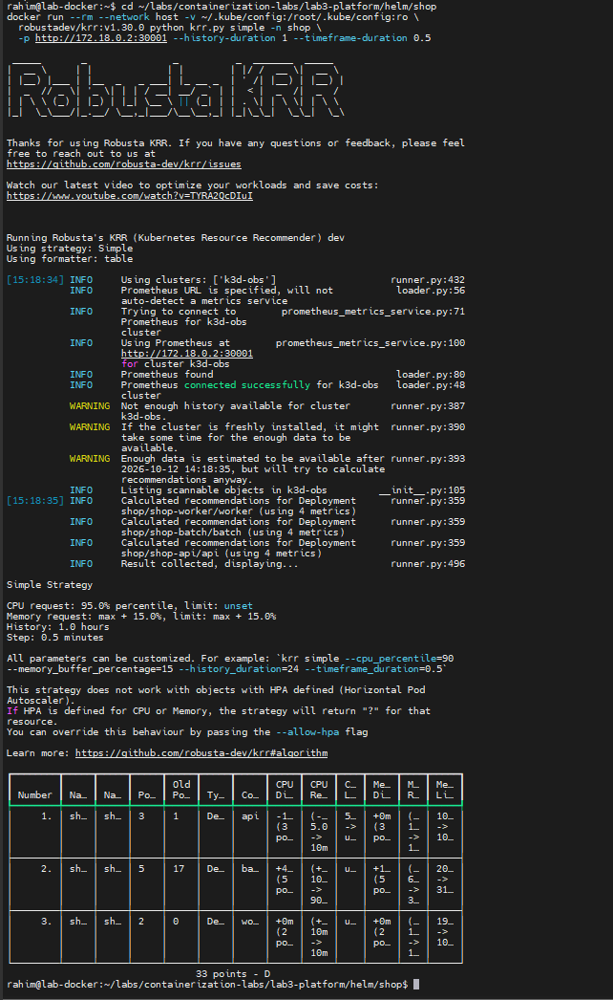
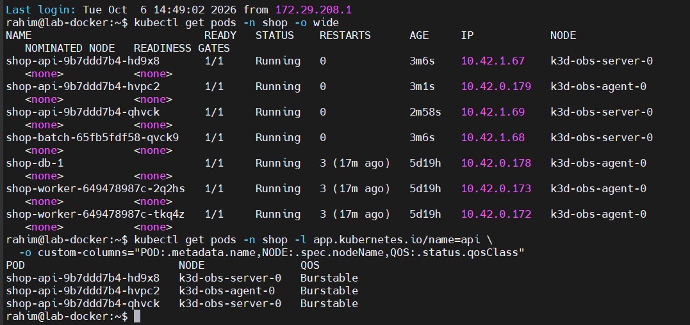
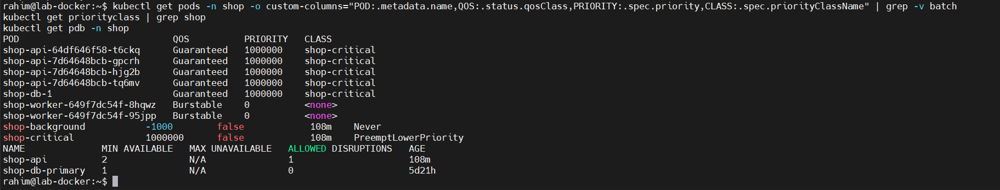
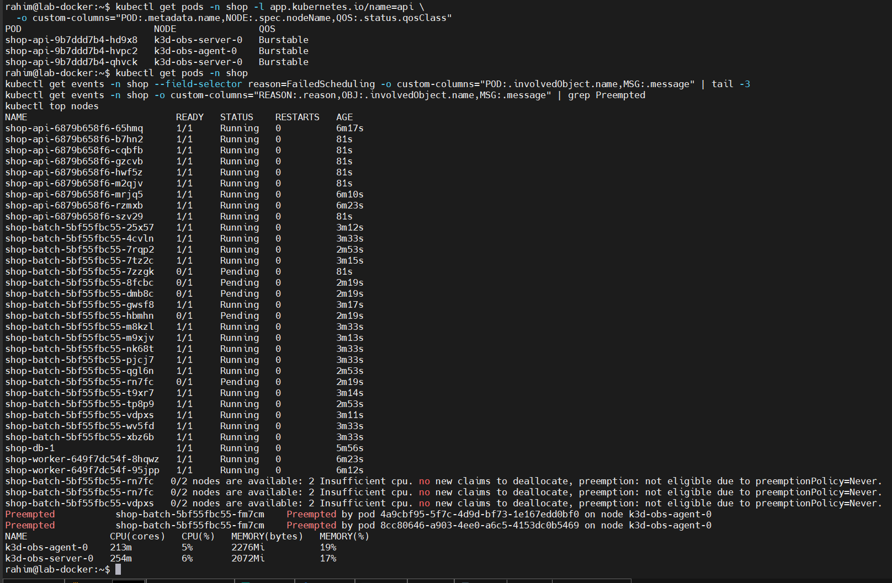
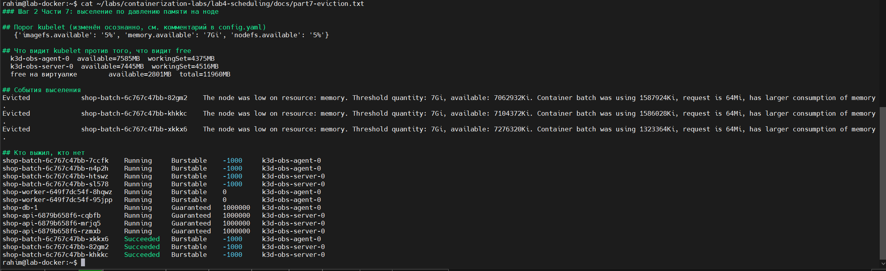
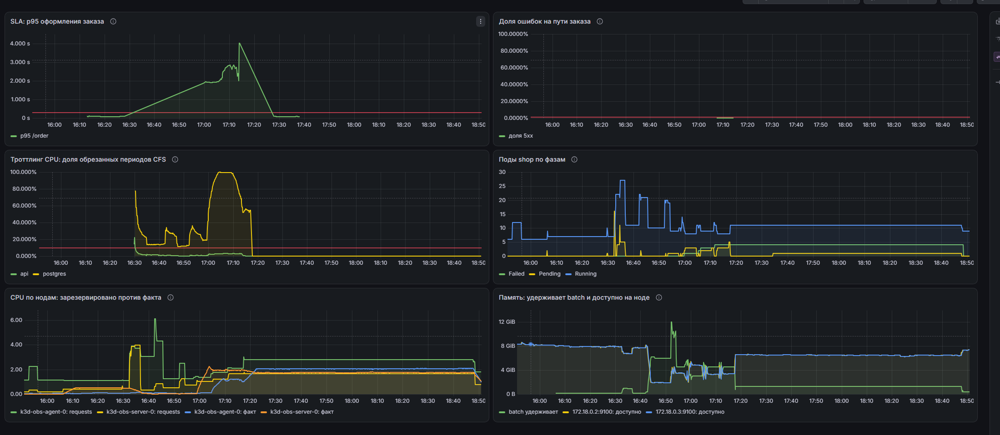
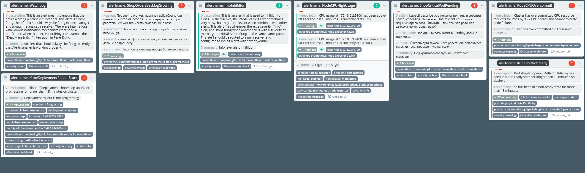

# Лабораторная работа 4. SLA критического пути под перегрузкой

Лаба отвечает на вопрос, который в эксплуатации возникает рано или поздно: что именно сломается, когда кластеру перестанет хватать ресурсов, и можно ли заранее решить, что сломается первым.

Сквозной пример тот же магазин `shop`. У него есть критический путь, оформление заказа через `api` в `postgres`, и есть фоновая работа, которой под давлением не жалко пожертвовать. Задача не в том, чтобы всё работало, а в том, чтобы деградация была управляемой: чтобы падала именно фоновая часть, а путь заказа держал обещанное время ответа.

Главный урок оказался не там, где я его ждал. Я готовился показывать вытеснение и выселение, а самым дорогим открытием стал процессорный лимит, который я же и поставил ради правильного класса обслуживания и которым сам же сломал SLA.

Среда: тот же кластер k3d на двух нодах, что во второй и третьей лабах, со стеком мониторинга из второй. Вся настройка идёт через чарт `shop` из третьей лабы, разовых `kubectl patch` в работе нет.

---

## Шаг 0. Сервис batch

Заглушка «ночной аналитики»: жжёт процессор и держит память, не делая ничего полезного. Положил её командой `cmd/batch` в тот же модуль Go, где уже живут `api` и `worker`, потому что в их `Dockerfile` есть `ARG CMD` и отдельный файл сборки не понадобился.

### 1. Нагрузка задаётся переменными окружения

Все шесть параметров читаются из окружения: число горутин, скважность, стартовая память, скорость роста, потолок и адрес. Решение не косметическое. В Частях 6 и 7 нагрузку приходится наращивать по шагам, и если зашить числа в код, каждый шаг означал бы пересборку образа и `k3d image import`. С переменными меняется только `values.yaml`.

### 2. Память записывается постранично

```go
b := make([]byte, 1<<20)
for p := 0; p < len(b); p += pageSize {
    b[p] = 1
}
```

Цикл записи здесь **обязателен**. `make` сам по себе почти ничего не стоит: Go получает виртуальный диапазон, а физические страницы ядро выделяет лениво, при первом обращении. Без записи по байту в каждую страницу RSS не вырастет, cgroup не увидит потребления, и давления на ноду не возникнет. Проверил на дымовом прогоне: при `BATCH_MEM_MB=32` и росте по 16 МБ в секунду до потолка `BATCH_MEM_MAX_MB=96` метрика `batch_memory_held_bytes` показала ровно 96 МиБ, а `process_resident_memory_bytes` 107 МиБ, то есть страницы действительно материализовались, а разница ушла на сам рантайм.

### 3. У процессорной нагрузки есть скважность

Параметр `BATCH_CPU_DUTY_PERCENT` задаёт долю времени под нагрузкой внутри стомиллисекундного периода. Это защита от ложного диагноза. Под процессорным лимитом тугой цикл съедает весь выделенный квант, HTTP-обработчик не успевает ответить на пробу за её `timeoutSeconds`, kubelet считает контейнер мёртвым и перезапускает его. В эксперименте это выглядело бы как вытеснение, хотя причина совсем другая. По той же причине пробам у `batch` в чарте заданы щадящие `timeoutSeconds` и `failureThreshold`.

Арифметика скважности подтвердилась на дымовом прогоне: два воркера по 50% дали ровно 100% одного ядра.

<details><summary><b>Примечание: сколько ядер видит рантайм Go</b></summary>

До версии 1.25 рантайм Go читал число логических процессоров машины и ставил `GOMAXPROCS` по нему, не зная про квоту cgroup. Контейнер с лимитом в четверть ядра на сорокаядерной машине запускал сорок потоков выполнения, которые дрались за одну четвёртую, и получал лишнюю задержку на переключениях контекста.

С версии 1.25 рантайм учитывает лимит cgroup и ставит `GOMAXPROCS` по нему, если тот меньше числа ядер. Проверить это можно метрикой `batch_gomaxprocs`, которую `batch` отдаёт специально: без лимита она равна четырём, то есть числу ядер виртуальной машины.

У JVM такая автоматика появилась раньше: `UseContainerSupport` включён по умолчанию с JDK 10, и `Runtime.availableProcessors()` с тех пор учитывает квоту cgroup. А вот размер пула потоков в Node и число воркеров в типичных рантаймах скриптовых языков по-прежнему приходится задавать руками.

</details>

### 4. У заглушки есть HTTP-сервер

Сервис ничего не обслуживает, но сервер ему нужен: политика `require-probes` из третьей лабы требует обе пробы без исключений, а задание прямо говорит, что гвардрейлы действуют и на `batch`. Заодно `/metrics` отдаёт три собственные метрики, и одна из них, `batch_gomaxprocs`, пригодилась для наблюдения за тем, сколько ядер видит рантайм Go против того, сколько разрешает cgroup.

Метрики поехали в Prometheus сами, без правки `ServiceMonitor`. Он отбирает сервисы по метке `app.kubernetes.io/part-of` и порту с именем `http`, и я дал `batch` ровно такие. Это побочная польза от того, что в третьей лабе отбор сделали по метке, а не перечислением.

---

## Шаг 1. Выбор механизма разнесения

Задание требует добавить в `values.yaml` переключатель между `podAntiAffinity` и `topologySpreadConstraints` и обосновать выбор. Механизмы решают разные задачи, и разница глубже, чем «жёстко или мягко».

### 1. Как считает podAntiAffinity

Для каждой ноды-кандидата планировщик проверяет, есть ли в этом топологическом домене хоть один под, подходящий под `labelSelector`. Если есть, нода отбраковывается в жёстком варианте или штрафуется при оценке в мягком. Это попарное сравнение «я и соседи».

Правило бинарное. Понятия равномерности в нём нет вообще: оно умеет **только запрещать соседство**. Если реплик больше, чем доменов, жёсткий вариант оставляет лишние в `Pending` **навсегда**, не временно, а до появления новой ноды.

Есть и менее очевидная беда. У `api` в чарте стоит `maxUnavailable: 0` и `maxSurge: 1`, то есть во время обновления появляется лишний под. При жёсткой антиаффинности, когда все домены заняты подами старой версии, новому встать некуда, а старый снять нельзя. Выкатка встаёт **намертво**.

### 2. Как считает topologySpreadConstraints

Здесь планировщик держит счётчик подходящих подов по доменам, вычисляет перекос как разницу между данным доменом и самым пустым, и отбраковывает ноду, если размещение подняло бы перекос выше `maxSkew`. Это **не сравнение с соседями, а работа со счётчиками**, поэтому и дешевле.

Жёсткость вынесена в отдельное поле `whenUnsatisfiable`, то есть переключается без переписывания правила.

<details><summary><b>Примечание: что именно считается перекосом</b></summary>

Перекос это разница между числом подходящих подов в данном домене и минимумом по всем **подходящим** доменам. Последнее слово важно: что считать подходящим, зависит от двух полей.

`nodeAffinityPolicy` решает, учитывать ли ноды, отсечённые `nodeSelector` и аффинностью. `nodeTaintsPolicy` решает то же про ноды с тейнтами, которые под не терпит. По умолчанию оба стоят в `Honor` и `Ignore` соответственно, то есть отсечённые аффинностью домены из расчёта выпадают, а тейнтованные остаются.

Отсюда неочевидное следствие: добавление `nodeSelector` меняет не только набор кандидатов, но и само значение перекоса, потому что меняется знаменатель. В этой лабе до такого расчёта дело не дошло: общий селектор из третьей лабы оставлял ровно один подходящий домен, и я снял его с `api` одновременно с добавлением правила, не проверяя вырожденный случай отдельно.

</details>

<details><summary><b>Примечание: зачем matchLabelKeys</b></summary>

По умолчанию в счётчик попадают поды всех ревизий, и старые, и новые. Во время выкатки это может оставить новому поду меньше места, чем есть на самом деле. Поле `matchLabelKeys: [pod-template-hash]` велит считать только поды своей ревизии. На Kubernetes 1.35 оно стабильно, поэтому добавил его сразу, а не после того, как упрусь.

</details>

### 3. Арифметика решила за меня

У `api` три реплики, кластер по условию на одну или две ноды. Расклад считается в уме.

| Вариант | Три реплики на двух нодах | Доказуемость |
|---|---|---|
| `podAntiAffinity`, жёсткий | две размещены, третья в `Pending` навсегда | доказывать нечего, состав неполон |
| `podAntiAffinity`, мягкий | все три размещены, вероятно 2 и 1 | совпадение, а не гарантия |
| `topologySpreadConstraints`, `maxSkew: 1` | 2 и 1, перекос равен единице | гарантировано правилом |

Ключ в последней строке. Распределение 2 и 1 даёт перекос ровно 1, что допуск разрешает, поэтому все три реплики встают, и при этом на одной ноде их заведомо не больше двух. Жёсткая антиаффинность такого компромисса выразить не может в принципе: у неё нет понятия «можно двоих, но не троих».

Поэтому дефолтом взял `topologySpreadConstraints`. Шаблоны в чарте поддерживают оба механизма плюс режим `none`, выбор делает `spread.mode`.

---

## Шаг 2. Тесная площадка

Кластер остался прежним, две ноды k3d, что укладывается в требование «строго одна или две». `batch` добавил новым шаблоном в чарт `shop`, с запросами и лимитами, как у любого другого пода: гвардрейлы третьей лабы действуют без исключений.

### 1. Ловушка стенда, которую надо понимать заранее

```
k3d-obs-agent-0    cpu: 4   memory: 11.7Gi
k3d-obs-server-0   cpu: 4   memory: 11.7Gi
```

Обе ноды рапортуют полные ресурсы виртуальной машины, потому что контейнеры нод по умолчанию ничем не ограничены и читают `/proc` хоста. Планировщик считает, что у него восемь ядер и 23 ГБ, тогда как физически их четыре и 11.9.

В Части 6 это оказалось кстати: нехватку я создавал через `requests`, а реальное потребление держал низким, и получился чистый эксперимент без риска уронить машину. В Части 7 та же особенность едва не сорвала работу.

---

## Шаг 3. Реальные числа вместо угадывания

### 1. Запуск krr

Перед запуском прогнал по пути заказа десятиминутную нагрузку k6 на 50 запросов в секунду, чтобы Prometheus накопил потребление. Без этого инструмент считал бы рекомендации по простою.

`krr` запускал контейнером с сетью хоста: так он видит и API-сервер, и Prometheus по NodePort через адрес контейнера ноды.

Первый запуск дал рекомендации только для `api`, а `worker` и `batch` получили «Not enough data». Причина в пороге: стратегия требует сто точек данных, а час истории с шагом в минуту даёт шестьдесят. Уменьшил шаг вдвое, и для `api` с `worker` данных хватило. `batch` рекомендаций так и не получил: к моменту запуска он прожил около двадцати минут, то есть меньше требуемого окна, и в таблицу ниже не попал.

<details><summary><b>Примечание: почему именно сто точек</b></summary>

Документация замысел не объясняет, но арифметика подсказывает причину. Стратегия `simple` считает по процессору 95-й перцентиль, а перцентиль по шестидесяти точкам означает, что отсекаются ровно три замера. Любой единичный всплеск при таком объёме данных либо полностью определяет результат, либо полностью из него выпадает.

Инструмент предпочитает отказаться от ответа, а не выдать число, за которым не стоит статистики. Это честнее, чем молча вернуть что-нибудь правдоподобное, но стоит помнить: понизив порог флагом, рекомендации получить можно всегда, и выглядеть они будут точно так же убедительно.

</details>

Инструмент при этом честно предупреждает, что истории ему мало, и называет время, после которого данных хватит:

```
WARNING  Not enough history available for cluster k3d-obs
WARNING  Enough data is estimated to be available after 2026-10-12 14:16:35,
         but will try to calculate recommendations anyway
```

Предупреждение стоит принимать всерьёз. Кластер к тому моменту работал меньше часа после перезапуска, и рекомендации построены на коротком окне, в которое попал единственный прогон нагрузки. Для настоящего продакшена окно берут в дни, и числа были бы другими.



Кадр снят повторным запуском, уже после того, как рекомендации были внесены в `values.yaml`, поэтому колонка «было» в нём показывает новые значения, а не исходные. Числа первого запуска, с которыми и велось сравнение выше, лежат в [docs/krr-report.json](docs/krr-report.json).

### 2. Чего krr не увидел вовсе

`postgres` в отчёт не попал. Его подом управляет напрямую объект `Cluster` оператора CloudNativePG:

```
ownerReferences: [{apiVersion: postgresql.cnpg.io/v1, kind: Cluster, name: shop-db}]
```

Никакого `StatefulSet` между ними нет. `krr` обходит стандартные контроллеры, и ресурс, которым управляет чужой CRD, для него **невидим**. Числа для базы пришлось считать руками по тем же метрикам, которыми пользуется сам инструмент.

Вывод неприятный и важный: чем больше в кластере операторов, тем больше слепых зон у инструментов, которые ходят по стандартным типам.

### 3. Три числа из четырёх оказались порогами

Сравнил рекомендации с тем, что показывают сырые запросы к Prometheus за то же окно.

| Контейнер | Факт за час | Рекомендация krr | Откуда взялось число |
|---|---|---|---|
| `api`, CPU | 95-й перцентиль 17m на под | 17m | настоящий перцентиль |
| `api`, память | максимум 23.8Mi | 100Mi | нижний порог `mem-min` |
| `worker`, CPU | 95-й перцентиль 0.35m на под | 10m | нижний порог `cpu-min` |
| `worker`, память | максимум 10.6Mi | 100Mi | нижний порог `mem-min` |

У `krr` есть пороги `--cpu-min` со значением 10 миллиядер и `--mem-min` со значением 100 мегабайт. Для мелких сервисов они перекрывают любой расчёт, и инструмент возвращает **не измерение, а свою нижнюю границу**. Понять это по таблице с рекомендациями невозможно, нужен отдельный запрос в Prometheus.

### 4. Сравнение с изначальной догадкой

В третьей лабе числа брались на глаз: `api` и `worker` по 20m процессора и 48Mi памяти, `postgres` 50m и 256Mi.

По процессору догадка оказалась разумной. Для `api` 20m против измеренных 17m это почти попадание. Для `postgres` 50m против измеренных 25m это ровно двукратный запас, что для базы на критическом пути нормально.

По памяти догадка была щедрой: 48Mi при фактическом максимуме 23.8Mi у `api` и 256Mi при 72Mi у базы. То есть в два и в три с половиной раза больше нужного. Для `requests` это не страшно, но съедает место в расчётах планировщика.

Самое интересное расхождение не в числах, а в принципе. `krr` ставит лимит памяти равным запросу и при этом не советует лимит процессора вовсе. Логика здравая. Память несжимаема, лимит выше запроса лишь откладывает неизбежный OOM, поэтому их имеет смысл уравнять. Процессор сжимаем, его лимит не убивает под, а добавляет задержку, поэтому лимита лучше не ставить.

Часть 5 требует класс `Guaranteed`, а он без лимита процессора невозможен. Это прямое противоречие между советом инструмента и заданием, и я разрешил его в пользу задания. Чем это кончилось, написано в Шаге 8.

---

## Шаг 4. Разнесение критического сервиса

### 1. Общий селектор нод обессмысливал всё

В `values.yaml` третьей лабы лежал один `nodeSelector` на все компоненты, жёстко прибивающий их к рабочей ноде. Пока он такой, никакое разнесение не работает: отсев по `nodeSelector` происходит на этапе фильтрации, то есть раньше правил размещения, и оставляет планировщику единственного кандидата. Разносить **нечего**.

Сделал селектор покомпонентным. `postgres` остался на рабочей ноде, потому что там физически лежит его том `local-path` и переезд оставил бы базу без данных. `worker` остался тоже. `api` получил пустой селектор, то есть обе ноды.

### 2. Доказательство

```
shop-api-9b7ddd7b4-hd9x8   k3d-obs-server-0
shop-api-9b7ddd7b4-hvpc2   k3d-obs-agent-0
shop-api-9b7ddd7b4-qhvck   k3d-obs-server-0
```

Две реплики на серверной ноде, одна на рабочей. Перекос равен единице и укладывается в `maxSkew: 1`. **Ни одного `Pending`.**



Позже, в Части 6, состав `api` временно вырос до девяти реплик, и распределение осталось сбалансированным: пять и четыре. Правило держит баланс и на выросшем составе, без участия человека.

Отказоустойчивость от этого растёт буквально: при двух нодах и трёх репликах отказ любой ноды уносит максимум две из трёх, то есть сервис продолжает отвечать оставшейся. Без разнесения отказ одной ноды унёс бы все три сразу, и `maxUnavailable: 0` в стратегии выкатки от этого не спас бы, потому что он про обновление, а не про аварию.

---

## Шаг 5. Приоритеты, гарантии и бюджеты

### 1. Guaranteed требует лимита по процессору

Класс обслуживания Kubernetes не задаётся полем, он выводится из ресурсов. `Guaranteed` даётся, только если у каждого контейнера пода `requests` равны `limits` и по памяти, и по процессору. Одного равенства по памяти мало, получится `Burstable`.

<details><summary><b>Примечание: откуда вообще берётся класс обслуживания</b></summary>

Поля `qosClass` в манифесте нет, его вычисляет kubelet при создании пода по трём правилам, в таком порядке:

| Условие | Класс |
|---|---|
| ни один контейнер не объявил ни `requests`, ни `limits` | `BestEffort` |
| у каждого контейнера `requests` равны `limits` по памяти и по процессору | `Guaranteed` |
| всё остальное | `Burstable` |

Проверка на `Guaranteed` включает и инициализирующие контейнеры, а не только основные. Отсюда частая неожиданность: под с идеально выставленным основным контейнером оказывается `Burstable` из-за забытого `initContainer`.

Класс определяет две вещи: порядок выселения при нехватке памяти и значение `oom_score_adj`, которое kubelet проставляет процессу. В журнале ядра из этой лабы видно `oom_score_adj:995` у `batch`, то есть ядро выберет его жертвой раньше почти всего остального даже при общесистемной нехватке.

</details>

В третьей лабе лимита процессора не было сознательно, чтобы не ловить троттлинг, и политика `require-resources` его не требует. Ради `Guaranteed` пришлось его добавить. Размен я тогда сформулировал так: берём предсказуемый порядок вытеснения в обмен на возможный троттлинг. Насколько дорого обошлась вторая часть этого размена, выяснилось в Шаге 8.

### 2. Почему у фонового класса отрицательное значение

```
shop-critical     1000000   PreemptLowerPriority
shop-background      -1000   Never
```

Отрицательное значение здесь не для красоты. Под без `priorityClassName` получает приоритет **ноль**, а не «самый низкий». Если бы я дал `batch` любое положительное значение, он оказался бы выше `worker`, у которого класса нет вовсе, хотя `worker` куда полезнее:

```
shop-api-...      Guaranteed   1000000   shop-critical
shop-db-1         Guaranteed   1000000   shop-critical
shop-worker-...   Burstable          0   <none>
shop-batch-...    Burstable      -1000   shop-background
```

Значение критического класса, наоборот, намеренно далеко от системных. У `system-cluster-critical` оно два миллиарда, и подниматься к нему нельзя: спасая заказы, можно вытеснить компоненты control plane и уронить кластер целиком.

### 3. Политика вытеснения Never

У фонового класса вытеснение выключено. Это значит, что `batch` можно вытеснить, но сам он не вытесняет никого: при нехватке места он просто ждёт. Фоновой работе уместно уступать, но не отнимать.

Решение оказалось видимым в эксперименте. Когда реплик `batch` стало больше, чем помещается, планировщик написал про них:

```
preemption: not eligible due to preemptionPolicy=Never
```

### 4. Бюджет нарушений, и чей он

```
shop-api          minAvailable 2   ALLOWED DISRUPTIONS 1
shop-db-primary   minAvailable 1   ALLOWED DISRUPTIONS 0
```

Первый мой, второй **создал оператор CloudNativePG сам**. У базы ноль допустимых нарушений, потому что экземпляр один: `kubectl drain` на её ноде просто встанет и будет ждать. Ещё один пункт в копилку различий между оператором и обычным контроллером из третьей лабы.

<details><summary><b>Примечание: что PDB не делает</b></summary>

`PodDisruptionBudget` ограничивает только добровольные выселения: `drain` ноды, обновление кластера, работу автоскейлера. На вытеснение планировщиком по приоритету он не влияет, и на выселение kubelet под давлением ресурсов тоже. Это механизмы разных уровней, и путать их опасно: PDB не спасёт от нехватки памяти, он про плановые работы.

</details>



---

## Шаг 6. Нехватка: Pending и вытеснение

### 1. Как создать нехватку, не убив машину

Планировщик складывает `requests`, а не фактическое потребление. На этом и построил эксперимент: `batch` получил крупный запрос процессора и почти нулевую реальную нагрузку. Ноды выглядят забитыми, а физически простаивают.

Наращивал реплики по шагам. Двенадцать разместились, шестнадцать тоже, на двадцати появился `Pending`.

```
16 Running
 4 Pending
```

### 2. Что при этом происходит на самом деле

| Нода | Зарезервировано по requests | Фактически используется |
|---|---|---|
| `server-0` | 3870m из 4000m, 96% | 243m, 6% |
| `agent-0` | 3900m из 4000m, 97% | 205m, 5% |

Ноды заняты на 96% и простаивают на 94% **одновременно**. Противоречия нет: это два разных числа про разные вещи. Первое про обещания, второе про факт, и планировщик смотрит **только на первое**.

Сообщение планировщика объясняет и отказ, и то, почему никто не был вытеснен:

```
0/2 nodes are available: 2 Insufficient cpu.
preemption: not eligible due to preemptionPolicy=Never.
```

Вторая строка это прямое следствие решения из Части 5. `batch` не пытается никого подвинуть, он ждёт.

### 3. Вытеснение

Чтобы увидеть вытеснение, поднял число реплик `api` с трёх до девяти. Своего приоритета у него миллион против минус тысячи у фона, и политика `PreemptLowerPriority`.

```
Preempted  shop-batch-5bf55fbc55-fm7cm  Preempted by pod ... on node k3d-obs-agent-0
```

Все девять реплик `api` разместились, а у `batch` стало на один работающий под меньше. Планировщик не стал ждать освобождения места: он выбрал жертву с наименьшим приоритетом и удалил её.

Любопытная деталь: одна и та же жертва числится вытесненной дважды, ради двух разных подов `api`. Вытеснение считается отдельно для каждого ожидающего пода, и оба независимо назначили одного и того же кандидата.

<details><summary><b>Примечание: вытеснение и выселение это разные механизмы</b></summary>

Слова похожи, и путаница стоит дорого, потому что настраиваются они в разных местах.

| | Вытеснение (preemption) | Выселение (eviction) |
|---|---|---|
| Кто решает | планировщик | kubelet на конкретной ноде |
| Когда | под не влезает по `requests` | ресурс ноды кончается по факту |
| По какому признаку выбирает жертву | приоритет | класс обслуживания и превышение над `requests` |
| Что учитывает | `priorityClassName`, `preemptionPolicy` | `qosClass`, пороги `evictionHard` |
| Видно в | событии `Preempted` | событии `Evicted` |

Разница принципиальная: вытеснение работает с обещаниями и случается ещё до того, как под запустился, а выселение работает с фактом и случается с уже работающими подами. Настроив приоритеты, от выселения не защитишься, и наоборот.

</details>



---

## Шаг 7. Давление по памяти и порядок жертв

Самая содержательная часть, и единственная, где пришлось менять настройки самого кластера.

### 1. В k3s порога по памяти нет вообще

Первым делом посмотрел, при каких условиях kubelet вообще начинает выселять:

```
evictionHard: {'imagefs.available': '5%', 'nodefs.available': '5%'}
```

Сигнала `memory.available` здесь **нет**. В ванильном Kubernetes по умолчанию стоит `memory.available<100Mi`, а k3s заменяет весь набор порогов на два дисковых. То есть выселения по памяти на таком кластере не происходит **никогда**: сколько ни наливай, сработает ядерный OOM-киллер, а это совсем другой механизм.

Само по себе это хороший ответ на вопрос задания о двух диагнозах с одинаковым симптомом. Они различаются ещё и тем, что второй в этой сборке выключен по умолчанию.

### 2. Контрольный опыт: OOMKilled по своему лимиту

Прежде чем включать порог, воспроизвёл первый из двух диагнозов. Задал `batch` потребление 256 МБ при лимите 128Mi, то есть заведомо выше собственного потолка.

Kubernetes показал это так:

```
restarts=4  reason=Error  exit=137
```

Код 137 это 128 плюс 9, то есть SIGKILL. Но причина указана просто как ошибка, а не как OOM. Настоящий диагноз нашёлся в cgroup и в журнале ядра:

```
memory.max        134217728     ровно 128Mi, наш limits.memory
oom               5
oom_kill         10
oom_group_kill    5
```

```
oom-kill:constraint=CONSTRAINT_MEMCG
Memory cgroup out of memory: Killed process 85912 (app) anon-rss:129792kB oom_score_adj:995
```

`CONSTRAINT_MEMCG` означает, что убийство ограничено своей cgroup, а не нехваткой памяти на машине. `anon-rss` в 129792 КБ это 126.7 МиБ, то есть процесс уткнулся ровно в свой потолок.

Убитых задач десять, а событий пять, потому что включён `memory.oom.group`: cgroup v2 убивает **всю группу целиком**, а не только самого прожорливого.

<details><summary><b>Примечание: почему reason=Error, а не OOMKilled</b></summary>

Поле `reason` в статусе пода заполняется из того, что сообщил рантайм контейнеров. Здесь он вернул обычное завершение по сигналу, и Kubernetes показал `Error`, хотя счётчики cgroup и журнал ядра однозначно говорят про OOM по собственному лимиту.

Практический вывод простой: на поле `reason` нельзя полагаться как на единственный источник. Диагноз ставится по `memory.events` и `dmesg`, а статус пода это пересказ, который может потеряться по дороге.

</details>

### 3. Почему порог пришлось ставить в 7Gi

Включил сигнал по памяти через `/etc/rancher/k3s/config.yaml` в контейнерах нод, со значением `memory.available<4Gi`. Запустил рост памяти, довёл свободную память виртуальной машины с 7.2 ГБ до 1.97 ГБ, и не добился ничего: `MemoryPressure` остался `False`, никого не выселили.

Разгадка в том, как kubelet считает доступную память:

| Источник | Доступно |
|---|---|
| `free` на виртуальной машине, правда | 1983 MB |
| kubelet на `agent-0` | 6985 MB |
| kubelet на `server-0` | 7492 MB |

Два kubelet в сумме насчитали 14477 МБ свободной памяти на машине, где её всего **11960 МБ**. Это та же особенность k3d, что и с процессором в Шаге 2, но здесь она ломает уже не наглядность, а логику: контейнер ноды берёт из `/proc/meminfo` хоста общий объём как свою ёмкость, а рабочий набор считает только по своей cgroup. Потребление соседней ноды каждый из них видит как свободную память.

Поэтому порог в 4Gi недостижим в принципе: чтобы `agent-0` увидел у себя меньше четырёх гигабайт, его собственный рабочий набор должен превысить 7.7 ГБ, а столько свободной памяти на машине уже нет. Ядро убьёт процессы раньше.

Поставил порог в системе координат самого kubelet, 7Gi, и это сработало.

### 4. Выселение

```
Evicted  shop-batch-6c767c47bb-xkkx6
  The node was low on resource: memory. Threshold quantity: 7Gi, available: 7276320Ki.
  Container batch was using 1323364Ki, request is 64Mi,
  has larger consumption of memory.
```

Выселены три пода, **все `batch`**. Не тронуты ни `api`, ни `postgres`, ни `worker`.

Правило отбора написано прямо в сообщении: `has larger consumption of memory` относительно `request`. kubelet ищет **не самого крупного потребителя**, а того, чьё потребление сильнее всего превышает заявленный запрос. Поэтому `worker` в кандидаты не попал, хотя он тоже `Burstable`: он потребляет 10Mi при запросе 100Mi, то есть **меньше заявленного**. А `api` и `postgres` защищены вдвойне, классом `Guaranteed` и приоритетом.



### 5. Чем это отличается от OOMKilled

| | OOMKilled по своему лимиту | Выселение по давлению ноды |
|---|---|---|
| Кто убивает | ядро, OOM-киллер cgroup | kubelet |
| Что превышено | `memory.max` своей cgroup | порог `memory.available` ноды |
| Сигнал | SIGKILL, шанса завершиться нет | SIGTERM, штатное завершение |
| Фаза пода | `CrashLoopBackOff`, растут рестарты | `Succeeded`, под удаляется |
| Кого выберут | того, кто превысил свой лимит | того, чьё потребление дальше всего от его `requests` |
| Где правда | `memory.events`, `dmesg` | событие `Evicted` с цифрами |

Поды после выселения оказались в фазе `Succeeded`, а не `Failed`, потому что `batch` корректно обрабатывает SIGTERM и выходит с кодом ноль. kubelet выселяет **вежливо**, в отличие от ядра.

### 6. Побочный эффект, которого я не ждал

Когда `MemoryPressure` становится `True`, kubelet вешает на ноду тейнт `node.kubernetes.io/memory-pressure` с эффектом `NoSchedule`. На ноду перестаёт садиться **что бы то ни было**.

Поймал это неприятным способом. База как раз пошла на перезапуск из-за смены ресурсов, и оказалась бездомной:

```
0/2 nodes are available: 2 node(s) had untolerated taint(s).
```

Снять давление мало, надо ещё подождать: у kubelet есть `evictionPressureTransitionPeriod`, по умолчанию пять минут, чтобы состояние не мигало. Сколько именно держался тейнт, я не замерял: к началу наблюдения с момента снижения потребления уже прошло время, и в журнале он исчез между двадцатой и сороковой секундой, после чего база сразу разместилась.

Урок практический: давление по памяти бьёт не только по тем, кто его создал. Оно замораживает планирование на всей ноде, и под, которому не повезло перезапуститься в этот момент, встаёт в очередь, даже если памяти ему нужно немного.

---

## Шаг 8. SLA под нагрузкой

### 1. Что обещаем и чем меряем

SLA критического пути сформулировал так: **95% заказов быстрее 300 мс даже под перегрузкой, доля ошибок ниже 1%**. Оба числа записаны в сценарий k6 как пороги, поэтому прогон сам помечает себя провалившимся, если обещание не выполнено.

Исполнитель в сценарии `constant-arrival-rate`, то есть открытая модель: k6 держит заданную частоту запросов независимо от того, насколько медленно отвечает сервис. Закрытая модель с фиксированным числом виртуальных пользователей при замедлении сама снижает нагрузку и прячет деградацию, а нам нужно ровно обратное.

Отдельная оговорка про методику. k6 работает на той же виртуальной машине и конкурирует за процессор с `batch`, поэтому его цифры включают задержку планирования самого генератора. Серверную правду даёт гистограмма `api` в Prometheus, и ниже приведены оба числа.

### 2. Первый прогон провалился

Запустил нагрузку на 40 запросов в секунду одновременно с давлением от `batch` по процессору и памяти.

```
http_req_duration { path:order }  p(95) = 2.07s
http_req_failed   { path:order }  = 0.00%  (2 из 23932)
level=error  thresholds on metrics 'http_req_duration{path:order}' have been crossed
```

Серверная гистограмма показывала то же самое, около 1900 мс стабильно.

Показательно, что ошибок **практически нет**. Сервис не падал и не отдавал пятисотых, он просто стал **медленным в тридцать раз**. Это ровно то, о чём лекция говорит про сжимаемые ресурсы: память бьёт завершением, процессор бьёт задержкой.

### 3. Виноват оказался не тот, за кем я следил

| Контейнер | Доля обрезанных периодов CFS | Потребление против лимита |
|---|---|---|
| `postgres` | 99.7% | 49.0m при лимите 50m |
| `api` | 3.2% | 36.9m на три пода, около 12m при лимите 50m каждому |

`api` почти не троттлился, ему пятидесяти миллиядер хватало. А база сидела в своём потолке постоянно: **99.7%** стомиллисекундных периодов обрезались. Каждый заказ ждал базу, отсюда и две секунды на `/order`.

Причина целиком в моём решении из Части 5. Ради класса `Guaranteed` я добавил базе лимит процессора, равный запросу, а запрос взял 50m, число из третьей лабы, подобранное как двукратный запас над 95-м перцентилем.

### 4. Перцентиль годится для запроса, но не для лимита

Ошибка в том, что это **разные по смыслу числа**.

`requests` влияет только на планирование: сколько места зарезервировать. Для этого перцентиль подходит, потому что речь о среднем поведении на длинном окне.

`limits` работает иначе. Квота CFS выдаётся порциями на каждый стомиллисекундный период. Лимит в 50m это 5 мс процессорного времени за период. Запрос, которому нужно 20 мс, в такую порцию не укладывается и ждёт следующего периода, добавляя к своей задержке около сотни миллисекунд. Средняя загрузка при этом может быть скромной, и по графику потребления ничего не видно.

То есть лимит режет пики, а задержка делается именно на пиках. Размер лимита надо брать от пиковой потребности, а не от перцентиля. И `krr` ровно поэтому не советует лимит процессора вовсе: я пошёл против его рекомендации и получил ровно то, от чего он предостерегал.

Поднял `api` до 200m, базу до 500m, сохранив равенство запросов и лимитов, то есть класс `Guaranteed`.

<details><summary><b>Примечание: стоит ли вообще ставить лимит на процессор</b></summary>

Вопрос спорный, и у обеих сторон есть аргументы.

Против лимитов: процессор сжимаем, и под, который взял лишнее на пике, никому не мешает, пока ядра простаивают. Лимит в такой ситуации вредит только своему владельцу, добавляя ему задержку на пустом месте. Именно поэтому `krr` лимит процессора не рекомендует.

За лимиты: без них потребление непредсказуемо, шумный сосед отъедает чужое время, а запросы, рассчитанные по наблюдениям, перестают что-либо гарантировать. И главное, без лимита нельзя получить класс `Guaranteed`, то есть защиту от выселения.

В этой лабе выбор был предопределён заданием, но цена выбора оказалась измеримой: лимит, подобранный по перцентилю, увеличил время ответа в тридцать раз. Если лимит ставится, он должен быть щедрым, иначе лучше не ставить вовсе.

</details>

### 5. Второй прогон

| | Лимит 50m | Лимит 200m и 500m |
|---|---|---|
| `p95` оформления заказа, клиент | 2070 мс | **68 мс** |
| `p95` оформления заказа, сервер | около 1900 мс | **от 58 до 88 мс** |
| Троттлинг `postgres` | 99.7% периодов | **0.0%** |
| Троттлинг `api` | 3.2% периодов | **0.0%** |
| Доля ошибок | 0.00% | 0.00% |
| Порог k6 | нарушен | выдержан |

Обещание выполнено с **четырёхкратным запасом**, причём `batch` всё это время продолжал жечь процессор пятью подами. Деградировал именно он: при равной конкуренции за процессор фон получал ровно свою долю по весу запроса и не мог отобрать больше, а один его под так и не нашёл себе места и провисел в `Pending` весь прогон.

Важная оговорка про последовательность. Выселение по памяти случилось раньше, в Части 7, и на этот прогон не пришлось: перед ним я остановил рост памяти, иначе давление держало бы ноды в состоянии `MemoryPressure` и мешало планированию. То есть три механизма деградации наблюдались в трёх разных прогонах, а не одновременно в одном.

Это и есть ответ на вопрос лабы. Управляемая деградация получается не сама собой, а из трёх настроек сразу: класс `Guaranteed` защищает от выселения, приоритет определяет порядок жертв, а размер лимита решает, будет ли сервис вообще успевать отвечать.



На дашборде обе фазы видны рядом. Верхняя левая панель: `p95` поднимается с плато около 1.9 секунды до пика в четыре и возвращается под красную линию порога ровно тогда, когда лимиты были подняты.

Левая средняя панель объясняет причину. `postgres` стоит на отметке 100% обрезанных периодов весь отрезок аварии. У `api` там же видно другое: всплеск до 22% сразу после того, как лимит в 50m был применён, и дальше спад к единицам процентов, то есть ниже порога алерта. Это согласуется с замером из таблицы выше, где `api` в середине аварии троттлился на 3.2%: всплеск пришёлся на момент применения лимита, а не на пик нагрузки.

Отдельного внимания заслуживает верхняя правая панель. Доля ошибок всё время ноль, включая разгар аварии, когда заказы оформлялись четыре секунды. Сжимаемый ресурс не ломает сервис, он его замедляет, и мониторинг, построенный только на ошибках, такую деградацию не увидит вовсе.

---

## Шаг 9. Три алерта

Стек мониторинга из второй лабы, в чарте уже были `ServiceMonitor` и `PrometheusRule` с тремя алертами третьей лабы. Добавил отдельную группу `shop.resources`, не трогая существующую.

Алерты подбирал по принципу «три разных механизма, каждый невидим для остальных двух».

### 1. ShopCriticalPodPending

```promql
sum(kube_pod_status_phase{namespace="shop",phase="Pending",pod=~"shop-api-.*|shop-db-.*"}) > 0
```

Под критического пути не может разместиться. Фильтр по именам здесь **обязателен**: для `batch` состояние `Pending` штатное, это его роль в системе, и алертом быть не должно.

Ловит ситуацию из Части 6, где ёмкость кончилась по `requests`, а не по факту. Без алерта такое легко не заметить: оставшиеся реплики продолжают отвечать, метрики ошибок молчат, а запас прочности уже съеден.

### 2. ShopCriticalPathThrottled

```promql
sum by (container) (rate(container_cpu_cfs_throttled_periods_total{...}[5m]))
/
sum by (container) (rate(container_cpu_cfs_periods_total{...}[5m]))
> 0.1
```

Самый коварный отказ из трёх. Поды `Running` и `Ready`, перезапусков нет, потребление в пределах лимита, ни одна проба ничего не ловит, и при этом сервис медленный в тридцать раз.

Это **буквально тот** алерт, который поймал бы аварию из Шага 8. Я нашёл причину вручную, запросом к Prometheus, уже после того, как увидел проваленный SLA: от начала деградации до диагноза прошло около четверти часа, и то лишь потому, что я смотрел на прогон в упор. Алерт закрыл бы этот разрыв за свои пять минут и без участия человека.

### 3. ShopOrderLatencySLOBreach

```promql
histogram_quantile(0.95,
  sum by (le) (rate(http_request_duration_seconds_bucket{namespace="shop",path="/order"}[5m]))
) > 0.3
```

Два алерта выше сторожат известные причины, этот сторожит следствие. Нужен потому, что причин деградации всегда больше, чем предусмотрено, и симптом надо наблюдать независимо от гипотез о механизмах. Порог совпадает с обещанием SLA, то есть алерт срабатывает ровно тогда, когда нарушено обещание клиенту.

### 4. Срабатывание

Спровоцировал первый из трёх. Задал `api` запрос процессора в 5000m, то есть больше, чем `allocatable` любой ноды, временным `--set`, не меняя `values.yaml`. Благодаря `maxUnavailable: 0` работающие реплики продолжили обслуживать, а новая встала в `Pending`:

```
0/2 nodes are available: 2 Insufficient cpu.
preemption: 0/2 nodes are available: 2 Preemption is not helpful for scheduling.
```

Вторая строка отличается от Части 6 и стоит внимания. Там вытеснение помогало, и планировщик им воспользовался. Здесь он посчитал, что даже выселив всё подряд, 5000m не наберёт, и честно сообщил, что пытаться незачем.

Алерт перешёл в `firing` на 180-й секунде наблюдения и доехал до Alertmanager с меткой `severity: critical`. Шаг опроса у меня был двадцать секунд, так что это подтверждает `for: 3m` с точностью до шага, а не до секунды.



Заодно всплыли две детали. Системный `NodeCPUHighUsage` висел в состоянии `suppressed`: его подавил ингибитор, потому что процессор жёг `batch`, и это правильное поведение, фоновая нагрузка не должна создавать шум в дежурстве.

А вот провокация с запросом в 5000m подняла заодно три встроенных алерта `kube-prometheus-stack`: `KubeCPUOvercommit`, `KubePodNotReady` и `KubeDeploymentRolloutStuck`. Каждый по-своему прав, и вместе они описывают ту же ситуацию с трёх сторон: ёмкость перезаказана, под не готов, выкатка не двигается. Мой алерт отличается от них тем, что называет причину сразу и в терминах приложения, а не кластера: в его `action` написано, куда смотреть и почему `Insufficient cpu` возможен на простаивающей ноде. Встроенные алерты отвечают «что», свои нужны для «почему» и «что делать».

### 5. Дашборд, который переживёт перезапуск

Дашборд второй лабы к началу этой работы исчез. Как именно он тогда заводился, в её отчёте не записано, но улики однозначны: `red-api.json` лежит в репозитории файлом, `ConfigMap` с меткой `grafana_dashboard` для него в кластере нет, и ни один шаблон чарта его не создаёт. Значит, он был импортирован руками через интерфейс, а такой импорт живёт во встроенной базе внутри пода Grafana. Перезапуски кластера пересоздали под, и дашборда не стало, причём **молча**: ни ошибки, ни следа в `helm list`.

Поэтому новый дашборд сделал шаблоном чарта. Он едет в кластер `ConfigMap`-ом с меткой `grafana_dashboard: "1"`, которую слушает sidecar Grafana из `kube-prometheus-stack`. Теперь он восстанавливается вместе с релизом, как и всё остальное.

Содержимое читается через `.Files.Get`. Это существенно: Helm такие файлы **не шаблонизирует**, и подстановки Grafana в легендах панелей доезжают целыми. Если вставить тот же JSON прямо в шаблон, Helm попробует раскрыть их как свои выражения и упадёт. Я на это наступил, причём не на самом дашборде, а на комментарии к нему, где упомянул такую подстановку текстом.

Шесть панелей расставлены парами по смыслу: сверху обещание (`p95` и доля ошибок), в середине причины (троттлинг и фазы подов), снизу ёмкость (процессор по нодам и память). Пороги SLA и алертов нарисованы на панелях линиями, чтобы глазами было видно то же, что видит Prometheus.

---

## Что получилось

| Требование | Результат |
|---|---|
| Реплики `api` разнесены по нодам | 2 и 1 на двух нодах, на девяти репликах 5 и 4, перекос всегда 1 |
| Числа взяты из `krr`, а не с потолка | да, с разбором того, какие из них реальные, а какие пороги инструмента |
| Лимиты есть у всех, включая `batch` | да, гвардрейлы третьей лабы без исключений |
| `Pending` и вытеснение увидены | 4 пода в `Pending` при 96% занятых `requests` и 6% реальной загрузки, вытеснение `batch` ради `api` |
| Выселение жертвует `batch` первым | три пода `batch` выселены, критический путь не тронут |
| SLA держится под перегрузкой | `p95` 68 мс против обещанных 300, ошибок 0.00% |
| Дашборд и три алерта в чарте | группа `shop.resources`, один доведён до `firing` |

Что лежит в репозитории:

| Файл | Что внутри |
|---|---|
| [`lab3-platform/src/cmd/batch/main.go`](../lab3-platform/src/cmd/batch/main.go) | заглушка фоновой нагрузки |
| [`lab3-platform/helm/shop/templates/batch.yaml`](../lab3-platform/helm/shop/templates/batch.yaml) | шаблон `batch` с пробами и ресурсами |
| [`lab3-platform/helm/shop/templates/_spread.tpl`](../lab3-platform/helm/shop/templates/_spread.tpl) | разнесение, оба механизма |
| [`lab3-platform/helm/shop/templates/priority.yaml`](../lab3-platform/helm/shop/templates/priority.yaml) | два класса приоритета |
| [`lab3-platform/helm/shop/templates/pdb.yaml`](../lab3-platform/helm/shop/templates/pdb.yaml) | бюджет нарушений для `api` |
| [`lab3-platform/helm/shop/templates/monitoring.yaml`](../lab3-platform/helm/shop/templates/monitoring.yaml) | группа алертов `shop.resources` |
| [`lab3-platform/helm/shop/templates/dashboard.yaml`](../lab3-platform/helm/shop/templates/dashboard.yaml) | дашборд как ConfigMap для sidecar Grafana |
| [`lab3-platform/helm/shop/files/dashboard-resources.json`](../lab3-platform/helm/shop/files/dashboard-resources.json) | сам дашборд, шесть панелей |
| [`cluster/k3s-eviction.yaml`](cluster/k3s-eviction.yaml) | порог выселения kubelet на нодах: без сигнала `memory.available` Часть 7 невозможна |
| [`load.js`](load.js) | сценарий k6 с порогами SLA |
| [`docs/krr-report.json`](docs/krr-report.json) | рекомендации `krr` |
| [`docs/krr-report.txt`](docs/krr-report.txt) | тот же отчёт в читаемом виде, как его печатает инструмент |
| [`docs/part6-preemption.txt`](docs/part6-preemption.txt) | доказательства `Pending` и вытеснения |
| [`docs/part7-oomkilled.txt`](docs/part7-oomkilled.txt) | OOM по своему лимиту: cgroup и журнал ядра |
| [`docs/part7-eviction.txt`](docs/part7-eviction.txt) | выселение по давлению ноды |
| [`docs/part9-alert-firing.txt`](docs/part9-alert-firing.txt) | алерт в состоянии `firing` |
| [`docs/k6-baseline.txt`](docs/k6-baseline.txt) | опорный прогон до перегрузки: `p95` 69 мс, ошибок 0% |
| [`docs/k6-before-fix.txt`](docs/k6-before-fix.txt) | проваленный прогон с лимитом 50m |
| [`docs/k6-after-fix.txt`](docs/k6-after-fix.txt) | тот же прогон после исправления лимитов |

---

## Вывод

Главное, что я вынес из этой лабы, оказалось не про вытеснение и не про выселение, хотя задумана она явно про них.

`requests` и `limits` выглядят как пара однородных настроек, и оттого соблазнительно задавать их одним числом с коэффициентом. Но это числа про разные вещи, и считаются они по разным правилам. `requests` это обещание планировщику, оно про среднее поведение, и перцентиль для него подходит. `limits` это потолок внутри каждого стомиллисекундного окна, он про пики, и перцентиль для него **не годится категорически**.

Класс `Guaranteed` вынуждает сделать их равными. То есть он **не бесплатный**: выбирая его, ты обязан задать запрос по пиковой потребности, а не по средней, и заплатить за это зарезервированным, но обычно простаивающим местом. Я этого не сделал и получил сервис, у которого все пробы зелёные, перезапусков нет, потребление в пределах лимита, а время ответа выросло в тридцать раз.

Второе наблюдение касается доверия к инструментам. `krr` не увидел базу, потому что ей управляет оператор, а не стандартный контроллер. Три из четырёх его рекомендаций оказались не расчётом, а нижними порогами, и отличить одно от другого по выводу невозможно. Поле `reason` в статусе пода показало обычную ошибку там, где ядро однозначно зафиксировало OOM. Два kubelet насчитали больше свободной памяти, чем физически есть на машине. Каждый из этих инструментов по-своему прав, но ни один не отвечает на вопрос целиком, и собирать картину всё равно приходится самому, спускаясь до `memory.events` и `dmesg`.

И третье, уже про устройство самой системы. Управляемая деградация не возникает оттого, что где-то проставлены приоритеты. Она складывается из трёх независимых механизмов: класс обслуживания решает, кого вообще можно выселить, приоритет решает порядок, а размер лимита решает, будет ли выживший при этом успевать работать. Выпадение **любого** из трёх ломает результат, причём по-разному и в разных местах.
