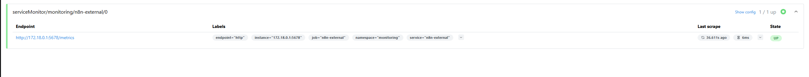
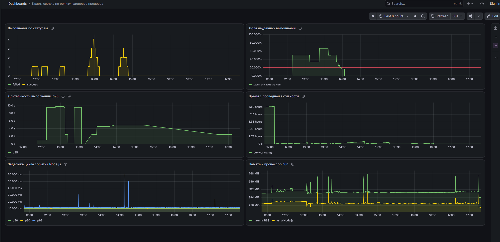
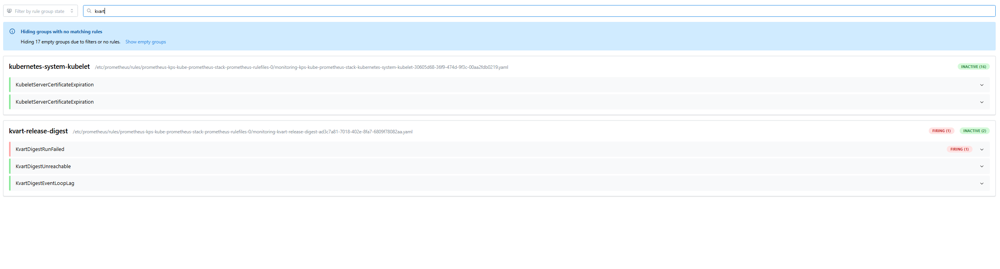

# Лабораторная работа 8. Сводка по релизу: агенты, MCP и цена ненадёжной модели

Лаба собирает один devops-процесс целиком: событие в репозитории, сбор данных обычными шагами, суждение модели, запись результата и мониторинг получившейся системы.

Кейс: дежурный по релизу в сервисе доставки продуктов получает release notes и задачу с чек-листом выкатки, аннотированным под конкретный релиз. Триггер это пуш тега, результат это файл на диске и задача в репозитории.

Главный урок оказался не в том, как связать n8n с MCP: это заняло один вечер. Дорогим открытием стало то, что **небольшая модель ненадёжна ровно в тех местах, где ей доверили решение или длинный текст**, и что надёжность пришлось возвращать не промптом, а структурой воркфлоу. Половина отчёта про это.

Среда: виртуальная машина с Docker, n8n `v2.42.7` и два MCP-сервера в Docker Compose, кластер k3d со стеком мониторинга из второй лабы. Модель `qwen/qwen3.8-27b` на бесплатном тарифе Groq.

---

## Шаг 0. Кейс

### 1. Компания и люди

«Кварт» это сервис доставки продуктов, примерно 300 человек. Команда платформы: 12 инженеров, из них **двое дежурят по неделе**. Сервисов около 40: заказы, курьеры, оплата, уведомления, API для партнёров.

Релизы выкатывает дежурный. Перед выкаткой он должен понимать, что именно едет на прод, и пройти чек-лист: прогнать миграции на стейдже, проверить оплату на тестовых картах, предупредить поддержку, посмотреть ошибки первые полчаса после выкатки.

### 2. Какую проблему решает

Руками это неудобно по трём причинам.

**Дифф между тегами читать долго.** Восемнадцать коммитов это полчаса на вычитывание, причём дежурный на этой неделе может не знать контекста половины из них.

**Чек-лист общий, а релизы разные.** Пункт «прогнать миграции на стейдже» в релизе без миграций это формальность, а в релизе с индексом по `created_at` в таблице заказов это главный пункт. Дежурный должен сам понять, какие пункты стали критичными, и именно это он пропускает, когда спешит.

**Никто не замечает пропуска.** Если задачи по релизу нет, это выглядит так же, как «релиза не было». Пропущенный пункт чек-листа всплывает уже на проде.

### 3. Что делает автоматизация

| | |
|---|---|
| **Кому помогает** | Конкретной группе: двум дежурным по релизу из команды платформы |
| **Триггер** | Пуш тега в репозиторий (вебхук) либо ручной запуск |
| **Шаги** | Собрать коммиты между предыдущим и текущим тегом, вытащить изменённые файлы по каждому коммиту, разметить признаки риска по путям, проверить, нет ли уже задачи по этому тегу, собрать release notes, записать файл, затем либо создать задачу с аннотированным чек-листом, либо отметиться в существующей |
| **Результат** | Файл `release-<тег>.md` с четырьмя разделами и задача в репозитории с аннотированным чек-листом |

Поток данных в виде, в котором он собран (27 узлов):

```
Запуск вручную ─┐
Вебхук: пуш тега ┴→ Параметры релиза → Производные значения →
  Коммиты между тегами → Развернуть коммиты → Файлы каждого коммита →
  Сжать коммиты → Задачи репозитория → Проверить дубль →
  [агент А] → Записать и проверить отчёт → Пауза: новая минута бюджета →
  Дубль задачи? ├─ нет → [агент Б] → Собрать тело задачи → Создать задачу →
                │                    Проверить созданную задачу
                └─ да  → [агент В] → Комментарии задачи → Проверить комментарий
```

Квадратные скобки это AI-шаги, всё остальное обычная логика и обычные вызовы сервисов. Обрати внимание на форму обеих ветвей: агент, затем проверка его работы обычным кодом. К этой форме я пришёл не сразу, и Шаги с 5 по 7 объясняют, почему без неё система выглядит работающей, не работая.

---

## Шаг 1. Стенд

### 1. Почему MCP-серверы в Docker, а не в кластере

Образ n8n весит 1.79 ГБ, и `k3d image import` на этой машине занимает минуты. Для лабы, где воркфлоу переимпортируется десятки раз, это неприемлемо. Стенд поднят в Docker Compose рядом с кластером, а мониторинг остался в k3d. Цена такого решения всплыла в мониторинге и разобрана в Шаге 9.

### 2. Два MCP-сервера

| Сервер | Образ | Что даёт | Инструментов отдаёт |
|---|---|---|---|
| filesystem | `node:22-alpine` + `@modelcontextprotocol/server-filesystem` | Чтение и запись в каталоге `/workspace` | 14 |
| github | `ghcr.io/github/github-mcp-server` | Задачи, коммиты, репозитории | 29 |

### 3. Зачем понадобилась прослойка supergateway

Узел `MCP Client Tool` в n8n умеет только два транспорта: `httpStreamable` и `sse`. Транспорта **stdio у него нет**, а официальный сервер filesystem умеет только stdio. Поэтому в образ вшита прослойка `supergateway`, которая поднимает stdio-сервер и выставляет его по HTTP:

```dockerfile
RUN npm install -g supergateway@latest @modelcontextprotocol/server-filesystem@latest

CMD ["sh", "-c", "supergateway \
  --stdio 'mcp-server-filesystem /workspace' \
  --outputTransport streamableHttp \
  --streamableHttpPath /mcp \
  --port 8001 \
  --host 0.0.0.0"]
```

Пакеты ставятся на этапе сборки, а не через `npx` при каждом старте: иначе контейнер тратит около минуты на загрузку при каждом перезапуске, а перезапусков за работу было много.

Сервер GitHub умеет HTTP сам, ему прослойка не нужна.

<details><summary><b>Примечание: аутентификация в GitHub MCP идёт по запросу, а не через окружение</b></summary>

Первая попытка выдала `401`. В режиме stdio сервер читает токен из переменной `GITHUB_PERSONAL_ACCESS_TOKEN`, а в режиме http **ждёт заголовок `Authorization: Bearer` в каждом запросе**. Это оказалось к лучшему: контейнер GitHub MCP не несёт токен в своём окружении, и `docker inspect` его не покажет. Токен лежит в учётных данных n8n типа Header Auth.

Токен тонкий (fine-grained), и прав ему нужно ровно два: `Contents: Read` для чтения коммитов и `Issues: Read and write` для задач.

</details>

<details><summary><b>Примечание: прокси, и почему «хост» для контейнера это не Windows</b></summary>

Прямого выхода в интернет у виртуальной машины нет, трафик идёт через прокси на Windows-хосте, порт 2080. Первая настройка упала с `proxyconnect tcp: dial tcp 172.17.0.1:2080: connection refused`, и ошибка была моя: я подставил `host.docker.internal`, рассуждая «прокси на хосте». Но для контейнера внутри виртуальной машины «хост» это сама виртуальная машина, а прокси живёт на Windows, то есть на хосте гипервизора. Адрес вычисляется из таблицы маршрутизации и кладётся в `.env` как `PROXY_URL`.

В `NO_PROXY` обязательны имена сервисов Compose (`mcp-filesystem`, `mcp-github`) и подсети Docker: иначе n8n пойдёт к своим же MCP-серверам через внешний прокси.

</details>

---

## Шаг 2. Шаги без AI: подготовка данных

Это та часть, где никакой модели нет и быть не должно. Её задача сделать так, чтобы модели досталась маленькая и уже осмысленная полезная нагрузка.

### 1. Сбор коммитов

Два HTTP-узла к API GitHub: сравнение тегов (`/compare/v2.7.0...v2.8.0`), затем по каждому коммиту отдельный запрос за списком изменённых файлов. Между ними узел `Развернуть коммиты`, который превращает один элемент со списком в 18 элементов.

На узле запроса файлов стоит повтор при ошибке (три попытки): восемнадцать последовательных запросов к внешнему API с прокси это достаточно поводов для случайного сбоя, и терять из-за одного из них весь прогон не хочется.

### 2. Разметка риска кодом

Признаки риска расставляются детерминированно, по путям изменённых файлов, до всякого обращения к модели:

```js
function riskOf(message, files) {
  const r = [];
  const has = (frag) => files.some(f => f.indexOf(frag) === 0 || f.indexOf('/' + frag) >= 0);
  if (has('db/migrations')) r.push('миграция');
  if (has('services/payments') || has('services/orders')) r.push('оплата-заказы');
  if (/откат|хотфикс/i.test(message)) r.push('откат-хотфикс');
  if (has('.github/workflows') || has('deploy/')) r.push('конфигурация-выкатки');
  return r;
}
```

Из 18 коммитов размечено 11. Модели остаётся **суждение**: что из размеченного важно дежурному, как это сформулировать и какие пять пунктов оставить.

### 3. Сжатие полезной нагрузки

После разметки пути файлов в нагрузку не попадают: они больше не нужны, а весили примерно половину всего списка. Коммит сжимается до трёх полей:

```json
{"sha": "7dffd7a", "msg": "Миграция: индекс по created_at в таблице orders", "risk": ["миграция"]}
```

Итог: **1838 символов, примерно 612 токенов** на все 18 коммитов. Зачем это нужно, стало понятно на Шаге 4.

### 4. Поиск дубликата и чтение чек-листа

Узел `Проверить дубль и прочитать чек-лист` делает две вещи обычным кодом. Ищет задачу с точно таким заголовком среди задач **в любом состоянии** и читает чек-лист с диска.

Сверка по `state=all` сделана намеренно: тег не переиспользуется, поэтому закрытая задача на тот же тег тоже значит «релиз уже разбирали».

Чек-лист читается здесь с диска, но **не для того, чтобы отдать его агенту**. Агент Б берёт чек-лист из репозитория сам, инструментом `get_file_contents`, потому что там он и живёт: это обязательства команды, которые правятся через пул-реквесты, а не файл на стенде. Копия с диска служит **эталоном**: узел `Собрать тело задачи` считает в ней пункты и сверяет с тем, сколько их осталось в теле, которое собрал агент. Так ловится случай, когда агент потерял пункт или выдумал свой.

<details><summary><b>Примечание: ноль элементов рвёт ветку воркфлоу</b></summary>

Если в репозитории ещё нет ни одной задачи, узел `Задачи репозитория` отдаёт пустой массив, и n8n **останавливает ветку**: узлов дальше просто не выполняется, причём без ошибки. Лечится флагом `alwaysOutputData: true` на узле запроса. Это один из тех случаев, когда отсутствие ошибки хуже ошибки.

</details>

---

## Шаг 3. Первая версия и первый отказ

Первая версия была устроена ровно так, как подсказывает интуиция: агент получает коммиты, читает шаблон через `read_text_file`, пишет отчёт через `write_file`, затем второй агент создаёт задачу через `issue_write`. Toolkit из пяти инструментов, дедупликация как правило в системном промпте, поиск дубликата через `list_issues`.

Интуиция оказалась неверной в каждом пункте, и дальше по шагам разобрано, в каком именно. Забегая вперёд: в итоговой версии у каждого агента остался **ровно один** инструмент, ни один документ не передаётся аргументом вызова, а все три правила, которые я держал в промптах, стали узлами.

Эта версия не работала, причём симптомы были разные от прогона к прогону:

| Симптом | Как выглядел |
|---|---|
| Агент не вызвал инструмент вовсе | Прогон `success`, файла нет |
| Пустой вывод модели | Прогон `success`, `llm.tokens.out: 0` |
| `tool_use_failed` | Прогон `error`, в ошибке обрезанный JSON |
| `429 rate_limit_exceeded` | Прогон `error` на последнем обращении, когда файл уже записан |

Четыре разных симптома, и соблазн лечить каждый по отдельности был сильным. Первые попытки были именно такими: добавить повторы на узел агента, усилить формулировку в промпте, уменьшить размер отчёта. Повторы сделали хуже: n8n при повторе перезапускает узел целиком, то есть агент заново тратит бюджет, которого и так не хватало.

---

## Шаг 4. Два лимита, из которых виден только один

### 1. Reasoning-токены съедают вывод незаметно

Первая настоящая причина нашлась при прямом замере через API, в обход n8n. Модель `openai/gpt-oss-120b` на реалистичном промпте:

| Модель | Токенов вывода | Из них размышление |
|---|---|---|
| `openai/gpt-oss-120b` | 2227 | **1537** |
| `openai/gpt-oss-20b` | 2943 | **2400** |
| `qwen/qwen3.8-27b` | 582 | 0 |

`gpt-oss` это reasoning-модели, и поле `completion_tokens_details.reasoning_tokens` показывает, сколько ушло на размышление. При `maxTokensToSample: 1500` размышление забирало бюджет, и аргумент `write_file` обрывался на 1174 символах. Все четыре симптома из таблицы выше сходились к этому.

### 2. Лимит, которого нет в заголовках

Переход на `qwen` снял размышление, но прогоны продолжали падать с `429`. Замер по заголовкам показывал запас:

```
x-ratelimit-limit-tokens: 8000
x-ratelimit-remaining-tokens: 7923
```

При этом отказ сообщал `Limit 7000, Used 6117, Requested 3199`. Расхождение я объяснить не мог и начал резать входной промпт. Замер показал, что прогон агента А стоит **7054 токена** на три обращения:

| Обращение | Вход | Выход | Что делает |
|---|---|---|---|
| 1 | 1814 | 34 | вызывает `read_text_file` |
| 2 | 2070 | 376 | вызывает `write_file` |
| 3 | 2478 | 282 | вызывает `write_file` **второй раз** |

Обрезка системного промпта с 2679 до 1844 байт дала 6691 токен. Запаса 309 токенов при разбросе вывода в сотню это рулетка, и я продолжил резать, пока не получил настоящую причину отказа:

```
on output tokens per minute (OTPM): Limit 1000, Requested 1244.
The request's expected output tokens exceed the enforced limit
```

**У Groq два независимых лимита.** TPM на 8000 токенов суммарно, который виден в заголовках, и **OTPM на 1000 токенов вывода в минуту, которого в заголовках нет вообще.** Проверяется он по *ожидаемому* выводу, который Groq оценивает из `max_tokens` ещё до генерации: при `max_tokens: 2000` запрос отбивался с «Requested 1244», хотя фактический вывод был 361 токен.

То есть полдня я оптимизировал не тот лимит. Вход был ни при чём.

<details><summary><b>Примечание: можно ли приглушить размышление и остаться на сильной модели</b></summary>

Да, у `gpt-oss` есть параметр `reasoning_effort`. Замер с `low`:

| Модель и режим | Вывод | Размышление | Результат |
|---|---|---|---|
| `gpt-oss-120b`, low | 49 | 15 | вызвал чтение шаблона |
| `gpt-oss-20b`, low | 790 | 319 | **сводка 1267 символов, все 4 раздела, целиком** |
| `gpt-oss-120b`, medium | 976 | 942 | вызвал чтение шаблона |

`gpt-oss-20b` с приглушённым размышлением пишет сводку целиком. Но на полном цикле размышление всё равно вышло в 2163 символа, и вместе со сводкой это около 1300 токенов вывода, то есть **за лимитом 1000**. В n8n это выглядело как успех с пустым результатом: генерация рвалась посреди JSON, LangChain выбрасывал битый вызов и отдавал пустую строку.

Попутно выяснилось, что узел `lmChatGroq` умеет только `model`, `temperature` и `maxTokensToSample`, а `reasoning_effort` ему недоступен. Параметр есть у узла `lmChatOpenAi`, и Groq говорит по OpenAI-совместимому протоколу, так что связка работает: учётные данные OpenAI с `url: https://api.groq.com/openai/v1`. Одна ловушка: у узла есть флаг `responsesApiEnabled` со значением по умолчанию `true`, а Responses API у Groq нет, поэтому его надо гасить явно.

Проверил и отбросил: ограничение в 1000 токенов вывода этим не обойти.

</details>

<details><summary><b>Примечание: гипотеза про кеширование промпта, которую пришлось отбросить</b></summary>

Поскольку системный промпт переотправляется с каждым обращением, напрашивалось кеширование: Groq его поддерживает. Проверил напрямую: одинаковый префикс на 5712 токенов был посчитан **полностью** на втором запросе, а поля `cached_tokens` в ответе не было вовсе. Гипотеза красивая, но измерение её не подтвердило.

</details>

### 3. Пауза между агентами

Лимит считается в минуту, то есть ожидание помогает. Между агентами стоит узел `Пауза: новая минута бюджета` на 90 секунд: агент А заканчивает в одной минуте, агент Б или В работает в следующей. Это добавляет к прогону полторы минуты, и для процесса, который запускается по пушу тега, такая цена приемлема.

### 4. Запас по бюджету там, где он неочевиден

Про OTPM важно помнить, что проверяется **ожидаемый** вывод, а не фактический. Пока у всех трёх агентов стоял общий потолок `maxTokensToSample: 900`, агент В резервировал более чем впятеро больше, чем тратит, и этот резерв учитывался в лимите наравне с настоящим расходом. Потолки приведены к измеренной потребности:

| Агент | Что пишет | Измеренный вывод | Потолок | Запас |
|---|---|---|---|---|
| А | Сводку до 1100 символов | от 411 до 459 токенов | 650 | около 30 процентов |
| Б | Тело задачи до 1200 символов, плюс вызов чтения | около 610 на два обращения | 750 | около 20 процентов |
| В | Комментарий до 300 символов | около 170 | 300 | около 40 процентов |

Отказ из-за бюджета выглядит обманчиво: в n8n он приходит как `The service is receiving too many requests from you`, то есть как слишком частые запросы. Настоящая причина видна только в поле `description` ошибки, и там она названа точно:

```
OTPM: Limit 1000, Used 705, Requested 411. Please try again in 6.96s.
```

`Used 705` это вывод первого обращения того же агента, `Requested 411` это оценка второго. То есть агент упёрся в лимит **сам в себя**, а не в соседа.

---

## Шаг 5. Почему промпт не является средством управления

Это главный вывод лабы, и он получен тремя независимыми наблюдениями.

### 1. Агент создал дубликат и сам же признался

Правило дедупликации было записано в системном промпте агента Б: «Если `duplicate` равно `true`, задачу НЕ создавай». В данных прогона `duplicate: true` стояло верно, узел его вычислил правильно. Агент создал задачу, а потом ответил:

> «Я ошибся, в задании было `duplicate: true`, поэтому задачу создавать нельзя. задача уже есть: .../issues/1»

То есть модель вызвала инструмент, а запрет применила уже после, к своему текстовому ответу. Для дежурного это две одинаковые задачи в репозитории.

### 2. Агент писал файл дважды

В промпте агента А стояло «`write_file` вызывается РОВНО ОДИН РАЗ. Повторный вызов запрещён». Третье обращение всё равно вызывало `write_file` снова. Усиление формулировки на «инструменты после записи недоступны» привело к тому, что третье обращение пошло **перечитывать шаблон**. Из цикла инструментов модель не выходит сама.

### 3. Агент выдумал пункты чек-листа

Здесь ошибка была моя: я требовал от агента А ссылаться на чек-лист, которого ему не передавал. Он честно сослался, выдумав названия пунктов. Правило убрано из промпта, а в сводке теперь прямо сказано «на чек-лист не ссылайся, ты его не видишь».

### 4. Чем заменено

| Было правилом в промпте | Стало |
|---|---|
| «Не создавай дубликат» | Узел ветвления `Дубль задачи?` по полю `duplicate`. Агент Б запускается только когда дубликата нет и про дубликаты не знает вовсе |
| «Вызови инструмент ровно один раз» | `maxIterations: 3` на узле агента, цикл ограничен сверху |
| «Выбери правильное действие» | У каждого агента **ровно один** инструмент. Агент А только читает шаблон, агент Б только читает чек-лист, агент В только комментирует. Запись в обоих случаях делает обычный узел |

Последняя строка самая важная. Пока у агента есть и `issue_write`, и `add_issue_comment`, он может выбрать не то. Когда инструмент один, выбирать нечего, а в итоговой версии инструментов записи у агентов не осталось вовсе: почему так вышло, разобрано в Шаге 6.

<details><summary><b>Примечание: ветвь дубликата перестала быть тупиком</b></summary>

Сначала при `duplicate: true` воркфлоу просто заканчивался заглушкой «задача уже есть». Это работало, но выбрасывало полезную работу: release notes уже собраны, а дежурный о повторной сборке не узнает. Теперь на этой ветви работает агент В с единственным инструментом `add_issue_comment`. Он оставляет в существующей задаче короткую отметку: релиз пересобран, три главных риска, что проверить.

Попутно нашёлся дефект выбора задачи. GitHub отдаёт задачи от новых к старым, и «первая совпавшая» оказывалась самой новой. Теперь берётся самая старая совпавшая, то есть исходная.

</details>

---

## Шаг 6. Почему документ не едет в аргументе инструмента

### 1. Наблюдение

После всех исправлений прогоны стали завершаться успехом, но отчёт выглядел так:

```
- Миграция: индекс по created_at в orders. https://gh/C
```

Обрыв на полуслове, трёх разделов из четырёх нет, при этом `finish_reason` равен `tool_calls`, а не `length`, вывод 224 токена при разрешённой тысяче. То есть модель посчитала вызов завершённым и обрыва **не заметила**.

Это оказалось не единичным сбоем, а свойством:

| Инструмент | Длина аргумента | Результат |
|---|---|---|
| `write_file` | 960 символов | целиком |
| `write_file` | 496 символов | обрыв на полуслове |
| `issue_write`, поле `body` | 1141 символ | целиком |
| `issue_write`, поле `body` | 0 символов | **поле не доехало вовсе** |
| `add_issue_comment`, поле `body` | 496 символов | обрыв на полуслове |

Порога по длине нет, надёжность просто около половины. Небольшая модель **ненадёжно дотягивает длинную строку внутри JSON-аргумента** вызова инструмента.

Самый показательный случай я получил замером в обход n8n, уже после того как запретил агенту Б рассуждать вслух. Модель выдала вызов на 101 токен:

```json
{"method":"create","owner":"CrazyCapislav","repo":"containerization-labs",
 "title":"Релиз v2.8.0: чек-лист выкатки","type":null}
```

Поля `body` здесь нет **вовсе**. Это не обрыв, а отказ его заполнять: в схеме `issue_write` семнадцать полей, обязательны три, и модель заполнила обязательные плюс `title`, а длинный `body` писать не стала. Явное требование в промпте («поле `body` в схеме необязательное, но передай его всегда») не изменило ничего.

Любопытно, что раньше тот же агент иногда тело заполнял. Запрет рассуждать вслух это поведение убрал: пока модель пересказывала себе задание, она доходила и до тела, а когда ей велели сразу вызывать инструмент, она стала следовать букве инструкции, где `body` в перечне полей не значился. То есть два моих исправления, каждое по отдельности разумное, вместе дали отказ.

### 2. Решение

Документ, который обязан дойти целиком, не передаётся аргументом инструмента. Агент А отдаёт сводку обычным текстом, а на диск её кладёт обычный узел:

```js
const text = ($('Агент А: release notes').first().json.output || '').trim();
const required = ['## Требует внимания', '## Что увидят',
                  '## Внутренние изменения', '## Миграции'];
const missing = required.filter(h => text.indexOf(h) < 0);
if (text.length < 400) throw new Error('сводка слишком короткая: ' + text.length);
if (missing.length) throw new Error('в сводке нет разделов: ' + missing.join('; '));
fs.writeFileSync(ctx.reportPath, text + NL, 'utf8');
```

Сравнение до и после, на том же наборе коммитов:

| Как пишется файл | Размер отчёта | Разделов из 4 | Хвост |
|---|---|---|---|
| Через аргумент `write_file` | 717 и 726 байт | 1 | обрыв на `https://gh/C` |
| Через узел из текста агента | 2291, 2360, 2515 байт | 4 | целый |

То же правило применено к агенту Б: он отдаёт тело задачи текстом, а задачу создаёт обычный HTTP-узел. Результат на том же наборе коммитов:

| Как создаётся задача | Тело | Пунктов чек-листа из 5 |
|---|---|---|
| Через аргумент `issue_write` | 0, 496 и 1141 символ в разных прогонах | 0, 3 и 5 |
| Через HTTP-узел из текста агента | 1477 символов | 5, аннотации на пунктах 1, 2 и 4 |

Для агента В вывод применён иначе: комментарий коротится до 300 символов и трёх рисков, потому что короткий аргумент модель дотягивает надёжно, и пять прогонов подряд это подтвердили. Это не стилистическое ограничение, а защита от обрыва.

<details><summary><b>Примечание: как из этого сложился набор инструментов</b></summary>

Правило вынесло из toolkit сразу два инструмента записи, `write_file` и `issue_write`, и осталось бы меньше требуемых трёх. Добирать счёт искусственными вызовами я не стал, вместо этого каждому агенту дан тот единственный инструмент, который ему действительно нужен:

| Агент | Инструмент | Почему именно он |
|---|---|---|
| А | `read_text_file` | Шаблон release notes лежит на стенде, рядом с отчётами |
| Б | `get_file_contents` | Чек-лист выкатки живёт **в репозитории** и правится через пул-реквесты, поэтому берётся оттуда |
| В | `add_issue_comment` | Короткая отметка в существующей задаче, аргумент короткий и потому надёжный |

Побочный эффект этого распределения важнее счёта: когда у агента один инструмент, выбрать не тот он не может. Это же закрыло проблему из Шага 5.

Все три узла MCP сужены фильтром `includeTools` до одного инструмента каждый, и это не косметика. Схемы доступных инструментов целиком попадают во **входной** контекст при каждом обращении к модели. Замер в символах JSON:

| Что отдаётся агенту | Размер схем |
|---|---|
| `read_text_file`, агент А | 840 символов |
| `get_file_contents`, агент Б | 1134 символа |
| `add_issue_comment`, агент В | 1242 символа |
| все 14 инструментов сервера filesystem | 8028 символов |
| все 29 инструментов сервера GitHub | **31245 символов** |

Последняя строка решает дело: без фильтра агент получал бы около восьми тысяч токенов одних только описаний инструментов при лимите TPM в восемь тысяч. То есть запрос не прошёл бы вообще, ещё до того, как в него добавили данные.

</details>

<details><summary><b>Примечание: зачем n8n разрешён модуль fs</b></summary>

Узлы Code в n8n по умолчанию не видят встроенных модулей Node.js. Для записи файла и чтения чек-листа нужен `fs`, поэтому в окружение добавлено `NODE_FUNCTION_ALLOW_BUILTIN: "fs"`. Именно `fs`, а не `*`: на учебном стенде это приемлемо, в продакшене такой флаг означает, что любой автор воркфлоу получает файловую систему контейнера.

</details>

---

## Шаг 7. Проверка побочных эффектов

Общее свойство всех отказов выше: **модель отчитывается успехом о работе, которой не сделала.** Прогон зелёный, файла нет. Прогон зелёный, тело задачи пустое. Значит результат нельзя принимать на веру, его надо вычитывать.

После каждого агента стоит проверка его побочного эффекта:

| Узел | Что проверяется | Когда |
|---|---|---|
| `Записать и проверить отчёт` | Все четыре раздела на месте, длина не меньше 400 символов, затем файл существует, больше 400 байт и моложе 60 секунд | после агента А |
| `Собрать тело задачи` | Длина не меньше 800 символов, хвост дописан, **пунктов чек-листа не меньше, чем в эталоне с диска** | до создания задачи |
| `Проверить созданную задачу` | GitHub вернул номер, сохранённое тело не короче отправленного | после создания |
| `Проверить комментарий` | Комментарий есть, длиннее 100 символов, хвост дописан | после агента В |

Две из них нуждаются в объяснении.

**Проверка хвоста.** Обрыв аргумента выглядит как текст, оборванный на полуслове, при успешном статусе вызова. Отличить его автоматически можно только по виду: текст, законченный на `.`, `)`, `!` или `:`, скорее всего дописан, а оборванный на середине слова нет. Эвристика грубая, но она превращает тихий отказ в громкий, а это и есть её задача.

**Проверка до записи, а не только после.** Созданную задачу нельзя отозвать программно, поэтому тело проверяется **до** вызова API. Проверка после создания тоже нужна, но отвечает на другой вопрос: дошло ли отправленное.

Проверка файла делается **на диске**, а не по переменной в памяти узла. Каталог `/workspace` смонтирован и в n8n, и в MCP-сервер файлов, и ошибку монтирования видно только так.

### Ловушка, из-за которой страховка не работала

Проверка комментария долго не срабатывала, и прогон без комментария оставался зелёным. Причина не в проверке, а в n8n: узел, вернувший **ноль элементов**, останавливает ветку молча, и следующий узел просто не выполняется. Пустой список комментариев это ровно тот случай, который проверка и должна ловить, то есть страховка отключалась именно тогда, когда была нужна.

Штатное лекарство, флаг `alwaysOutputData`, здесь **не помогло**: узел всё равно отдавал `{"main": [[]]}`. Сработал другой приём, не зависящий от флага: попросить у HTTP-узла полный ответ.

```js
options: { response: { response: { fullResponse: true } } }
```

Тогда узел отдаёт один элемент всегда, а массив комментариев лежит внутри него в поле `body`, и проверка выполняется в любом случае. После этого прогон без комментария впервые упал с внятной ошибкой: `агент не оставил комментарий в задаче #4`.

<details><summary><b>Примечание: третий инструмент, который сделал хуже</b></summary>

Сначала третьим инструментом я дал агенту В `issue_read`, чтобы перед комментарием он смотрел, что в задаче уже написано, и не повторялся. Замысел развалился сразу: прочитав комментарии, модель брала оттуда `comment_id` и подставляла его в `add_issue_comment`, где это поле означает **реакцию** на чужой комментарий. Сервер отбивал вызов:

```
comment_id cannot be combined with body
```

Два прогона подряд, причём второй уже с явным запретом в промпте: «поля `comment_id` и `reaction` не трогай». До появления `issue_read` тот же агент вызывал инструмент верно пять прогонов подряд.

Механизм тот же, что с пропавшим `body`, только наоборот: лишний контекст подтолкнул модель заполнить соседнее необязательное поле схемы. Инструмент снят, а третьим стал `get_file_contents` у агента Б, у которого аргументы короткие и идентификаторов в ответе нет.

</details>

<details><summary><b>Примечание: кто имеет право писать в каталог</b></summary>

Пока отчёт писал MCP-сервер, файл принадлежал `root`. После переноса записи в n8n писать стал процесс с `uid 1000`, и перезапись файла, принадлежащего `root`, упёрлась бы в права. Каталог `workspace` принадлежит `1000:1001`, а контейнер n8n работает под `uid=1000(node)`, поэтому запись проходит. Проверять это надо заранее: иначе ошибка прав выглядит в логе так же, как ошибка логики.

</details>

---

## Шаг 8. Запуск локально

### 1. Что нужно заранее

- Docker и Docker Compose.
- Ключ API Groq, бесплатного тарифа достаточно.
- Тонкий токен GitHub с правами `Contents: Read` и `Issues: Read and write` на тестовый репозиторий.
- Репозиторий с двумя тегами, между которыми есть коммиты. В этой работе это `v2.7.0` и `v2.8.0`, 18 коммитов.

### 2. Поднять стенд

```bash
cd stand
cp env.example .env
chmod 600 .env          # внутри токен GitHub
# заполнить GITHUB_PERSONAL_ACCESS_TOKEN и, если нужен прокси, PROXY_URL
docker compose up -d --build
```

Проверка, что MCP-серверы отвечают **по протоколу**, а не только слушают порт. Открытый порт тут ничего не доказывает: сервер может принимать соединение и отбивать рукопожатие MCP, и выглядеть это будет как молчащий агент. Скрипт `stand/mcp-probe.js` делает `initialize`, затем `tools/list`:

```bash
docker cp stand/mcp-probe.js n8n:/tmp/
docker exec n8n node /tmp/mcp-probe.js http://mcp-filesystem:8001/mcp
# initialize: HTTP 200, сессия нет
# инструментов: 14
docker exec n8n node /tmp/mcp-probe.js http://mcp-github:8082/mcp "$GITHUB_TOKEN"
# инструментов: 29
```

### 3. Завести воркфлоу

Через интерфейс n8n на `http://localhost:5678`: импортировать `workflow/kvart-release-digest.json`, создать учётные данные (Groq API и Header Auth с `Authorization: Bearer <токен GitHub>`), опубликовать.

Через CLI, если учётные данные уже созданы:

```bash
docker cp workflow/kvart-release-digest.json n8n:/tmp/
docker exec n8n n8n import:workflow --input=/tmp/kvart-release-digest.json
docker exec n8n n8n update:workflow --id=<ID> --active=true
docker compose restart n8n   # вебхук перерегистрируется при старте
```

<details><summary><b>Примечание: импорт отвязывает учётные данные, если их нет в файле</b></summary>

`n8n import:workflow` заменяет воркфлоу целиком. Если в экспортированном JSON нет блоков `credentials`, импорт **снимет привязки** у живого воркфлоу, и прогон упадёт на первом же обращении к GitHub. Проверять это надо до импорта, а не после. Там же: импорт всегда **деактивирует** воркфлоу, поэтому `update:workflow --active=true` и перезапуск обязательны, иначе вебхук не зарегистрируется.

</details>

### 4. Запустить

```bash
curl -X POST http://localhost:5678/webhook/kvart-release \
     -H "Content-Type: application/json" -d '{}'
```

Прогон занимает около **ста секунд**, из которых 90 это пауза на новую минуту бюджета модели. Результат:

```bash
cat stand/workspace/reports/release-v2.8.0.md
```

### 5. Что получилось на выходе

Отчёт на 2515 байт, четыре раздела. Фрагмент:

```markdown
## Требует внимания дежурного
- Миграция: индекс по created_at в orders, риск блокировок при выполнении.
  https://github.com/CrazyCapislav/containerization-labs/commit/7dffd7a
- Оплата: таймаут банка 3 на 8 секунд, затем откат, ретраи ломались.
  https://github.com/CrazyCapislav/containerization-labs/commit/5f5978f
...
## Миграции базы данных
1. Индекс по created_at в таблице orders.
2. Колонка idempotency_key в таблице payments.
```

Задача в репозитории с аннотированным чек-листом, тело 1477 символов, все пять пунктов на месте:

```markdown
1. **Прогнать миграции на стейдже с копией продовых данных** и замерить
   время выполнения. Длинная миграция на таблице заказов способна положить
   сервис: таблица большая, и блокировка на ней видна клиентам сразу.
   важно в этом релизе: добавление индекса по created_at в orders и колонки
   idempotency_key в payments. Блокировки на этих таблицах критичны для
   создания заказов и оплат.
2. **Проверить оплату и создание заказа** на тестовых картах и тестовом
   магазине. Это ядро, и проверка руками дешевле любого инцидента.
   важно в этом релизе: таймаут банка поднят до 8 сек, изменена валидация
   адреса и сборка корзины. Риск сбоев в ядре транзакций.
3. **Предупредить поддержку и операторов**, если меняется поведение,
   которое видят клиенты или курьеры.
```

Приписки стоят на пунктах 1, 2 и 4, а пункты 3 и 5, которых этот релиз не касается, оставлены как есть. Это и есть работа, ради которой здесь модель: отличить, какие обязательства стали критичными именно сейчас.

Если задача по тегу уже существует, прогон уходит в другую ветвь и оставляет в ней короткую отметку:

```
Релиз v2.8.0 пересобран. Дежурному проверить: 1) таймаут банка 8с, не ломает ли
ретраи (был откат); 2) миграции: индекс по created_at в orders и колонка
idempotency_key в payments, применились ли; 3) реплики заказов 4 на 6, хватает
ли ресурсов.
```

Доказательства по обеим ветвям: шесть прогонов подряд с полным отчётом, затем прогон с созданием задачи (тело 1477 символов) и прогон с отметкой в существующей (комментарий 244 символа). Отдельно стоит прогон, который **упал намеренно**: когда агент В не оставил комментарий, проверка остановила воркфлоу с ошибкой `агент не оставил комментарий в задаче #4`. До появления этой проверки тот же случай давал зелёный прогон и молчание.

---

## Шаг 9. Мониторинг

### 1. Как n8n попал в Prometheus

n8n отдаёт метрики в формате Prometheus сам, флагом `N8N_METRICS=true`, экспортер не нужен. Всего 72 метрики.

Сложность в том, что n8n живёт в Docker, а Prometheus в k3d, то есть целью скрейпа оказывается адрес **вне** кластера. Собрано так: Service **без селектора**, объект Endpoints с адресом вручную и ServiceMonitor с меткой `release: kps`, по которой оператор его подхватывает.

```yaml
# Service без селектора: поды за ним искать не нужно, поэтому контроллер
# эндпоинтов их не трогает и адрес остаётся тем, что записан руками.
apiVersion: v1
kind: Service
metadata:
  name: n8n-external
  namespace: monitoring
  labels:
    app.kubernetes.io/name: n8n   # по этой метке его найдёт ServiceMonitor
spec:
  ports: [{ name: http, port: 5678, targetPort: 5678 }]
---
# 172.18.0.1 это шлюз docker-сети кластера, то есть сама виртуальная машина,
# где опубликован порт 5678. Из подов кластера он маршрутизируется.
apiVersion: v1
kind: Endpoints
metadata:
  name: n8n-external
  namespace: monitoring
  labels:
    app.kubernetes.io/name: n8n
subsets:
  - addresses: [{ ip: 172.18.0.1 }]
    ports: [{ name: http, port: 5678 }]
---
apiVersion: monitoring.coreos.com/v1
kind: ServiceMonitor
metadata:
  name: n8n-external
  namespace: monitoring
  labels:
    release: kps    # без неё объект создастся, но сбор не начнётся
spec:
  selector:
    matchLabels: { app.kubernetes.io/name: n8n }
  endpoints: [{ port: http, path: /metrics, interval: 15s }]
```

Цель здорова, и это стоит показать: `1/1 up`, скрейп укладывается в 6 миллисекунд.



Обрати внимание на метку `instance="172.18.0.1:5678"`. Это адрес, записанный руками, и именно он делает алерт `KvartDigestUnreachable` уязвимым к ложным срабатываниям: при пересоздании сети k3d адрес сменится, Endpoints останется прежним, и алерт сообщит о недоступности n8n, хотя недоступен будет мониторинг.

### 2. Дашборд

Шесть панелей, uid `kvart-n8n`, разложен в Grafana через ConfigMap с меткой `grafana_dashboard: "1"`, чтобы переживал перезапуск.

| Панель | Запрос | Зачем |
|---|---|---|
| Выполнения по статусам | `sum by (status) (increase(n8n_workflow_execution_duration_seconds_count[10m]))` | Основной бизнес-показатель: сколько прогонов и чем закончились |
| Доля неудачных выполнений | отношение `status="failed"` к общему за час | Тренд, который не виден по абсолютным числам |
| Длительность, p95 | `histogram_quantile(0.95, ...)` | С оговоркой ниже |
| Время с последней активности | `time() - n8n_last_activity` | Признак того, что процесс жив и что-то делает |
| Задержка цикла событий | `n8n_nodejs_eventloop_lag_p50/p90/p99` | Состояние «жив, но плохо» |
| Память и процессор | `n8n_process_resident_memory_bytes`, `n8n_nodejs_heap_size_used_bytes` | Утечки и тренды |



На снимке видно поведение стенда за рабочий день. Доля отказов поднималась до 65 процентов, пока разбирались агенты, и упала до нуля после последних исправлений. Задержка цикла событий держится около 10 миллисекунд с редкими выбросами до 60, то есть до порога алерта в одну секунду там огромный запас, и порог явно нуждается в калибровке. Память растёт ступенями: каждая ступень это перезапуск n8n после очередного импорта воркфлоу, а не утечка.

<details><summary><b>Примечание: метрика длительности меряет не то, что кажется</b></summary>

Панель p95 показывает около 9.5 секунды, хотя прогон занимает около ста. Причина в исходнике n8n: гистограмма наблюдается на событии `workflow-post-execute` как `stoppedAt - startedAt`, а **узел паузы разрезает прогон на сегменты**. В метрику попадают два отрезка по отдельности: сбор данных с агентом А до паузы (те самые 9.5 секунды) и работа агента Б или В после неё (около 2 секунд). Самих 90 секунд ожидания в метрике нет вообще.

Практический вывод: сквозное время прогона этой метрикой не измеряется, и алерт «прогон идёт слишком долго» на ней построить нельзя. Если такой алерт понадобится, время придётся считать самому и отдавать отдельной метрикой.

</details>

<details><summary><b>Примечание: у метки status только два значения</b></summary>

```js
status: runData.status === 'success' ? 'success' : 'failed'
```

То есть `failed` это «не success». Отменённый вручную прогон (`canceled`), упавший процесс (`crashed`) и ошибка узла попадают в одну метку. Различить их метрикой нельзя, только по `execution_entity.status` в базе.

</details>

### 3. Три метрики для алертов

Воркфлоу запускается **по событию**, а не по расписанию, и это определяет выбор. Между релизами может пройти два дня без единого прогона, и это норма.

#### Алерт 1. Громкий отказ

```promql
increase(n8n_workflow_execution_duration_seconds_count{status="failed"}[15m]) > 0
```

Любой упавший прогон означает, что release notes или задача с чек-листом не появились, хотя тег уже есть. Порог ноль, потому что прогонов мало и каждый значим: ждать второго падения смысла нет. Окно 15 минут: прогон примерно в сто секунд успевает попасть в метрику, а дежурный узнаёт о проблеме до выкатки.

Ручная отмена прогона алерт поднимет, потому что попадёт в ту же метку `failed`: различить их метрикой нельзя.

А вот с перезапуском n8n вышло интереснее, и это я нашёл, только когда намеренно уронил прогон ради скриншота. Алерт **не сработал**. Метрика при этом была на месте:

```
n8n_workflow_execution_duration_seconds_count{status="failed"} = 1
increase(... {status="failed"}[15m])                           = 0
```

Причина в том, как устроен `increase`: он считает прирост **между наблюдениями внутри окна**. Серия `{status="failed"}` создаётся лениво, в момент первого отказа, и рождается сразу со значением 1. Наблюдения с нулём до неё не существует, прироста нет, выражение возвращает 0. Счётчики n8n сбрасываются при каждом перезапуске процесса, то есть **первый отказ после каждого рестарта этот алерт пропускал бы молча**, а рестарты у воркфлоу случаются при каждом импорте.

Самый простой из трёх алертов не сработал бы на первом же настоящем инциденте. Исправленное выражение:

```promql
increase(n8n_workflow_execution_duration_seconds_count{status="failed"}[15m]) > 0
  or
(
  n8n_workflow_execution_duration_seconds_count{status="failed"} > 0
  unless
  n8n_workflow_execution_duration_seconds_count{status="failed"} offset 15m
)
```

Второе слагаемое истинно ровно тогда, когда серии 15 минут назад ещё не было, то есть ловит именно первое появление счётчика и само перестаёт срабатывать, как только окно наполнится. После исправления алерт перешёл в `firing` на том же самом отказе.



Общий вывод за пределами этого алерта: **правило, которое не проверено на настоящем отказе, не работает.** Выражение выглядело очевидным, прошло ревью в голове и было бы сдано как готовое, если бы мне не понадобился скриншот.

#### Алерт 2. Тихий отказ

```promql
up{job="n8n-external"} == 0
for: 5m
```

Для событийного триггера тихий отказ выглядит так: тег запушен, а принять вебхук некому, и событие просто теряется. Отсутствие прогонов само по себе **ничего не говорит**, поэтому метрики вида `time() - n8n_last_activity > 3600` или «нет успехов за два часа» здесь негодны: они срабатывали бы почти всё время, пока релизов нет, и через неделю их начали бы игнорировать. Значимо только то, что n8n недоступен в момент, когда событие может прийти.

`for: 5m` отсекает единичный пропущенный скрейп.

Ложные срабатывания возможны и приняты сознательно: `up == 0` бывает и когда Prometheus не видит n8n из-за сети, а сам n8n жив. У этой цены на нашем стенде есть конкретное имя: цель это **вручную заданный объект Endpoints** на адрес `172.18.0.1`, и он не обновляется сам. Пересоздание сети k3d или смена подсети моста сделают Endpoints устаревшим, и алерт сработает на поломку мониторинга, а не n8n. Проверить и закрыть такой алерт дежурному быстро, поэтому цена приемлема.

#### Алерт 3. Деградация

```promql
n8n_nodejs_eventloop_lag_p99_seconds > 1
for: 10m
```

Задержка цикла событий это единственный из рассмотренных кандидатов, который описывает состояние «жив, но плохо» и прямо влияет на наш триггер. Если цикл событий занят, n8n отвечает на вебхук медленно, а GitHub ждёт ответа ограниченное время и при таймауте считает доставку неудачной. То есть деградация это прямой предшественник тихого отказа, и алерт даёт время вмешаться раньше.

Порог в одну секунду выбран как заведомо ненормальный для Node.js: на нашем стенде в покое p50 равен 0.00076 секунды. Порог нужно откалибровать по фактическому p99 за несколько дней работы.

#### Почему не два других кандидата

**Доля `failed/total`.** При нескольких прогонах в день доля прыгает между 0 и 100 процентами и по сути дублирует первый алерт: один упавший прогон из одного это уже громкий отказ. Как панель на дашборде доля полезна, как алерт нет.

**Рост памяти.** Это медленный тренд, ему место на дашборде. Утечка, дойдя до конца, всё равно проявится как падение процесса, и его поймают алерты 1 и 2.

#### Разница между вторым и третьим для дежурного

**Тихий отказ это потеря результата, о которой никто не узнает сам.** Релиз уходит без release notes и без задачи с чек-листом, а отсутствие задачи выглядит так же, как «релиза не было». Миграцию никто не прогнал на стейдже, и никто не понимает, что пункт пропущен. Это критичный алерт, по нему надо будить: реагировать нужно до выкатки, а цена промаха это непроверенная миграция на проде.

**Деградация это убывающий запас при живом результате.** Сейчас ничего не потеряно, бросать всё не нужно, разобраться надо в рабочее время, пока деградация не перешла в отказ. Это предупреждение низкой важности, будить по нему не надо.

Коротко: второй алерт говорит «ты уже что-то потерял и не знаешь об этом», третий «скоро начнёшь терять». Отсюда разная срочность и разный канал оповещения.

### 4. Известная дыра

Если n8n работает, но вебхук в GitHub удалён или настроен неверно, **ни одна из трёх метрик этого не заметит**. Прогонов нет, процесс жив, цикл событий свободен, всё зелёное. Закрыть дыру можно сверкой «теги за сутки против прогонов за сутки», но это отдельный источник данных и выходит за рамки лабы.

---

## Что получилось

Сверка с требованиями Части 2:

| Требование | Как закрыто |
|---|---|
| Триггер | Вебхук `POST /webhook/kvart-release` на пуш тега, плюс ручной запуск для отладки |
| AI- и не-AI-шаги | 9 узлов AI-части (три агента, три модельных узла, три узла инструментов MCP) и 18 обычных: 8 узлов кода, 5 HTTP-запросов, вебхук, ручной запуск, присваивание, пауза, ветвление |
| Минимум два MCP-сервера | filesystem (отдаёт 14 инструментов) и github (29), агентам открыто три |
| AI toolkit от 3 до 5 инструментов | Три, по одному на агента: `read_text_file`, `get_file_contents`, `add_issue_comment`. Имена, назначение и входы описаны в [`skills.md`](skills.md) |
| Описанные skills | Три skill в [`skills.md`](skills.md): сводка по релизу, тело задачи по чек-листу, отметка в существующей задаче |
| Конкретный результат | Файл `release-v2.8.0.md` на 2515 байт и задача в репозитории с телом на 1477 символов |
| Мониторинг и 3 метрики | Дашборд из шести панелей, три алерта обоснованы выше |

Числа прогонов за работу: 47 всего, из них 27 успешных, 18 с ошибкой и 2 отменённых. Отказы здесь не фон, а материал: каждый разобран выше, и почти все они до определённого момента выглядели успехами.

Что лежит в папке:

| Файл | Что это |
|---|---|
| `workflow/kvart-release-digest.json` | Итоговый воркфлоу, 27 узлов |
| `workflow/stage1-сбор-без-ai.json` | Промежуточная версия: только сбор данных, без AI |
| `workflow/stage2-агент.json` | Промежуточная версия: первый агент |
| `skills.md` | Toolkit и know-how агентов |
| `stand/compose.yaml` | n8n и два MCP-сервера |
| `stand/mcp-filesystem/Dockerfile` | Прослойка supergateway над stdio-сервером |
| `stand/mcp-probe.js` | Проверка MCP-серверов по протоколу, а не по открытому порту |
| `stand/workspace/release/` | Чек-лист выкатки и шаблон release notes |
| `monitoring/` | ServiceMonitor, Endpoints и дашборд |
| `docs/img/` | Скриншоты мониторинга |

---

## Что осталось открытым

**Повторные комментарии.** Дедупликация защищает от второй задачи, но не от второго комментария: пять прогонов подряд оставили в задаче пять почти одинаковых отметок. Дежурный откроет задачу и увидит простыню.

Очевидное решение я попробовал и отбросил: дать агенту В инструмент `issue_read`, чтобы он видел уже написанное и не повторялся. Это сломало вызов комментария, как разобрано в Шаге 7. Остаются два варианта, оба без участия модели в решении: сравнивать состав рискованных коммитов с предыдущим прогоном и комментировать только при изменении, либо обновлять единственный комментарий через `update_issue_comment` вместо добавления нового. Второй вариант меняет состав toolkit, поэтому требует отдельного захода.

**Калибровка порога деградации.** Порог в одну секунду взят как заведомо ненормальный, а не измеренный. Нужен фактический p99 за несколько дней.

---

## Вывод

Связать n8n, MCP-серверы и агентов оказалось простой частью. Сложной оказалась надёжность, и все её проблемы были одного рода: **модель сообщает об успехе работы, которой не сделала.**

Она пишет файл дважды, хотя запрещено. Создаёт дубликат задачи и признаётся в этом уже после вызова инструмента. Обрывает длинную строку посреди JSON и ставит `finish_reason: tool_calls`. Выпускает обязательное по смыслу поле `body`, потому что в схеме оно помечено необязательным. Ни один из этих отказов не виден по статусу прогона: он зелёный.

Отсюда четыре правила, которые я вынес из работы.

**Промпт это не средство управления.** Запрет в системном промпте модель применяет к своему текстовому ответу, а не к выбору инструмента. Если действие недопустимо, инструмента для него у агента быть не должно, а решение должно принимать ветвление. В итоговой версии у каждого агента ровно один инструмент, и выбирать ему нечего.

**Документ не едет в аргументе инструмента.** Небольшая модель ненадёжно дотягивает длинную строку внутри JSON, а иногда не пишет её вовсе. Агент отдаёт текст, побочный эффект выполняет обычный узел. Инструменты остаются там, где аргументы короткие: путь к файлу, номер задачи, строка комментария.

**Лишний контекст тоже вредит.** Это оказалось симметрично предыдущему. Дав агенту прочитать комментарии задачи, я получил вызов, в который он подставил `comment_id` из прочитанного, и сервер его отбил. Модель заполняет соседние поля схемы тем, что попалось под руку, поэтому отдавать ей надо не всё, что доступно, а ровно нужное.

**Побочный эффект проверяется, а не принимается на веру.** После каждого агента стоит узел, который вычитывает результат из системы и превращает тихий отказ в громкий. Проверка нужна и до записи тоже: созданную задачу уже не отозвать.

Отдельно стоит измерение вместо догадок. Полдня ушло на оптимизацию входного промпта, потому что заголовки ответа показывали лимит TPM и создавали ложное чувство запаса, а отбивал запросы лимит OTPM на токены вывода, которого в заголовках нет вовсе. Пока причина не измерена, лечение идёт наугад: я по очереди добавлял повторы, усиливал формулировки и резал промпт, и ни одно из этих действий причину не задевало.

Последнее наблюдение, которое стоило дороже всего: **два разумных исправления дали отказ вместе.** Запрет рассуждать вслух экономил бюджет вывода и был верным сам по себе. Перечисление полей в промпте было верным само по себе. Вместе они заставили модель буквально следовать перечню, где поля `body` не было, и тело задачи перестало доезжать совсем. Проверять после правки надо не только то, что чинил.
